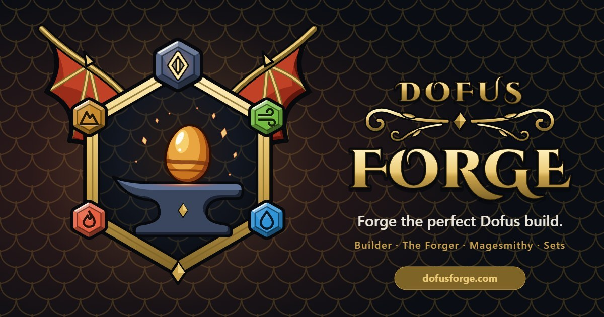

<div align="center">
  <a href="https://dofusforge.com">
    
  </a>

  <p>
    <a href="https://dofusforge.com"><strong>Enter the Forge ↗</strong></a>
    &nbsp;·&nbsp;
    <a href="https://github.com/Wembie/dofus-forge/issues">Report a bug</a>
    &nbsp;·&nbsp;
    <a href="./CONTRIBUTING.md">Contribute</a>
  </p>

  <p>
    <a href="https://github.com/Wembie/dofus-forge/actions/workflows/pr-checks.yml">
      
    </a>
    <a href="https://github.com/Wembie/dofus-forge/stargazers">
      
    </a>
    <a href="./LICENSE">
      
    </a>
    <a href="https://dofusforge.com">
      
    </a>
  </p>
</div>

<br>

> **A considered build planner for Dofus 3.** Shape your character, study every stat, and let the Forge search for the gear that fits your plan.

No account needed to start. No optimizer server to wait on. Your build, your rules.

<p align="center">
  <a href="#at-a-glance">At a glance</a> &nbsp;·&nbsp;
  <a href="#the-workbench">The workbench</a> &nbsp;·&nbsp;
  <a href="#get-started">Get started</a> &nbsp;·&nbsp;
  <a href="#built-with-care">Built with care</a> &nbsp;·&nbsp;
  <a href="#contributing">Contributing</a>
</p>

---

## At a glance

| | |
|---|---|
| **Live app** | [dofusforge.com](https://dofusforge.com) |
| **Game** | Dofus 3 |
| **Languages** | Español · English · Français · Português |
| **License** | [MIT](./LICENSE) |
| **Stack** | React · TypeScript · Rust · WebAssembly |

## The workbench

<table>
  <tr>
    <td width="50%" valign="top">
      <h3>01 · Plan your build</h3>
      Equip every slot, compare items, follow set tiers as they activate, and tune characteristics and scrolls. Search a deep catalog by name, level, set, type, or stat.
    </td>
    <td width="50%" valign="top">
      <h3>02 · Forge the combination</h3>
      Give the optimizer a target stat profile and let it explore item combinations in your browser. Pin must-have items, lock existing slots, set minimums and caps, and temper the results with exo and transcendence runes.
    </td>
  </tr>
  <tr>
    <td width="50%" valign="top">
      <h3>03 · Read the details</h3>
      Inspect item effects, set bonuses, spell modifiers, weapon damage, critical hits, and combat stats. Spell cards reflect the supported effects of your equipped gear.
    </td>
    <td width="50%" valign="top">
      <h3>04 · Share the result</h3>
      Save builds to your account, share a build link or image, compare two setups, and explore builds published by the community.
    </td>
  </tr>
</table>

### More in the Forge

- **Spell library** — spell cards, variants, grades, and class-by-class guides.
- **Magesmithy** — per-slot runes, craftsman signatures, elemental weapon transformations, and transcendence.
- **Build snapshots** — shareable URLs and exportable image cards.
- **Community** — discover published builds and manage your own saved builds.
- **Comfortable by design** — dark and light themes, with four interface languages.

## Get started

### What you need

- Node.js **22 or newer**
- pnpm **11 or newer**

### Run locally

```bash
git clone https://github.com/Wembie/dofus-forge.git
cd dofus-forge
pnpm install
pnpm dev
```

Vite prints the local URL when the development server is ready.

### Check your changes

```bash
pnpm build
pnpm lint
pnpm test
```

The optimizer's compiled WebAssembly and generated game data are checked in, so the app builds without Rust or a live game-data API. You only need Rust and `wasm-pack` when changing the optimizer itself:

```bash
cd rust-optimizer
cargo clippy --locked --all-targets -- -D warnings
cargo test --locked
cd ..
wasm-pack build rust-optimizer --target web --release --out-dir ../public/wasm --no-pack --locked
git diff --exit-code -- public/wasm
```

## Built with care

| Part | Choice |
|---|---|
| Interface | React 18 · TypeScript · Vite 6 |
| Build state | Zustand |
| Styling | Tailwind CSS · custom design tokens |
| Optimizer | Rust → WebAssembly · Web Worker |
| Data | Versioned static JSON · localized item and spell catalogs |
| Tests | Vitest · Playwright |
| Hosting | Cloudflare Worker · static assets |

### Game data

Catalog and spell data is generated from the public [DofusDude API](https://api.dofusdu.de) and checked into `public/data/`. The app reads these versioned files locally; normal development and builds do not depend on the API being available. Item images are served from project-managed assets.

To refresh game catalogs:

```bash
pnpm fetch-data           # fetch only when the game version changes
pnpm fetch-data --force   # force a refresh
```

Spell and image data have their own scripts: `pnpm fetch-spells` and `pnpm fetch-images`. Generated files should be refreshed through these scripts rather than edited by hand.

## Contributing

Thoughtful fixes and improvements are welcome. Start with [CONTRIBUTING.md](./CONTRIBUTING.md) for setup, project conventions, and pull request checks. For feature changes, open an issue first so we can align on the direction.

When reporting a bug, include the steps to reproduce it, what you expected, what happened instead, and your browser/device when relevant.

## A note on ownership

Dofus Forge is an independent community project and is not affiliated with Ankama Games. **Dofus**, the Krosmoz universe, and related game names and assets belong to their respective owners. Game data is attributed to the [DofusDude API](https://api.dofusdu.de). The source code is available under the [MIT License](./LICENSE).

<p align="center">
  <sub>Plan with intention. Forge with confidence.</sub>
</p>
