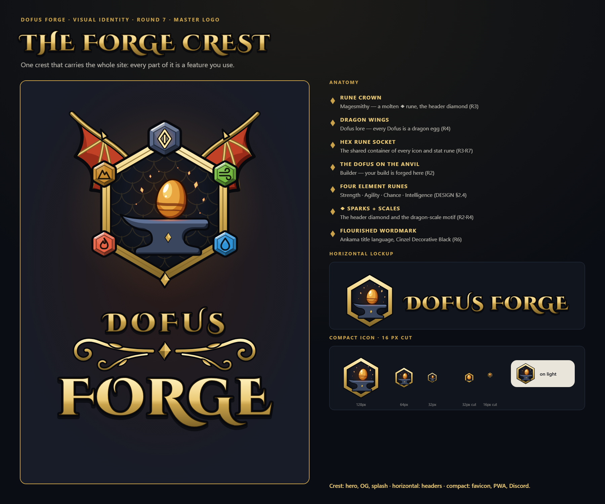
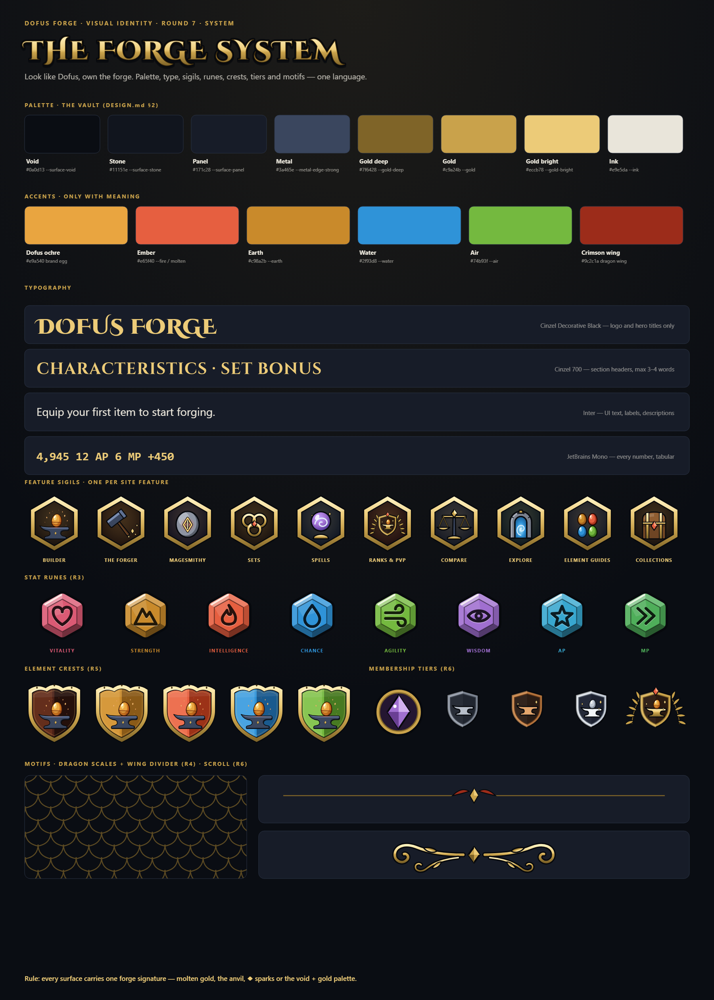
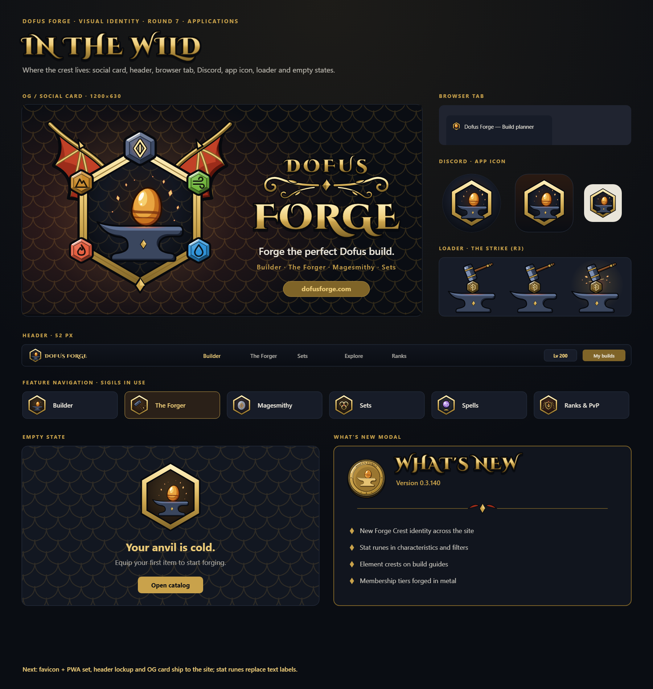
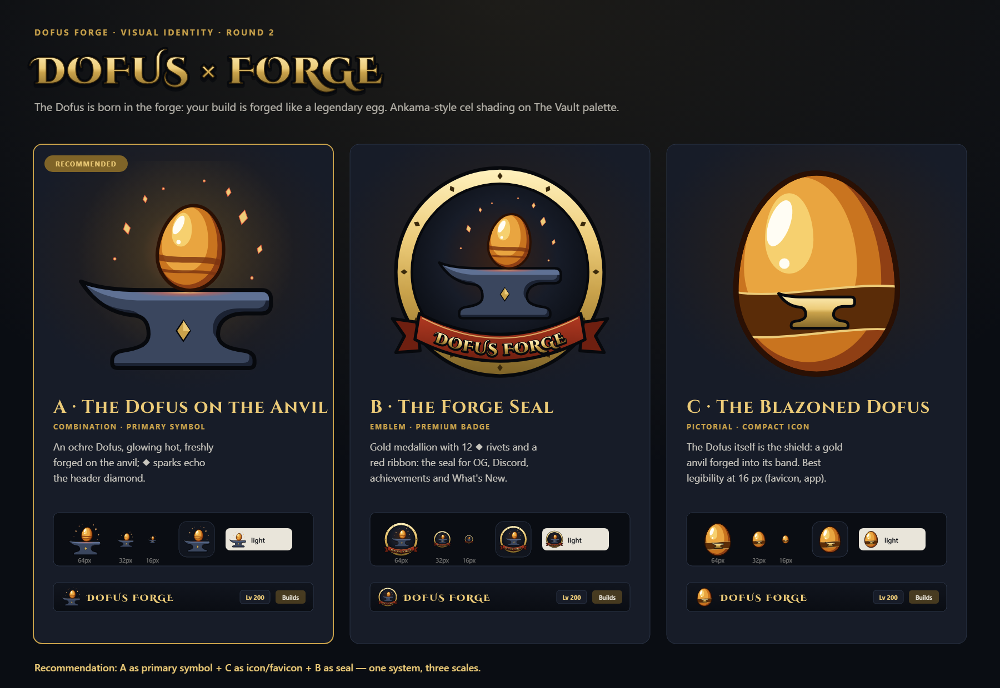
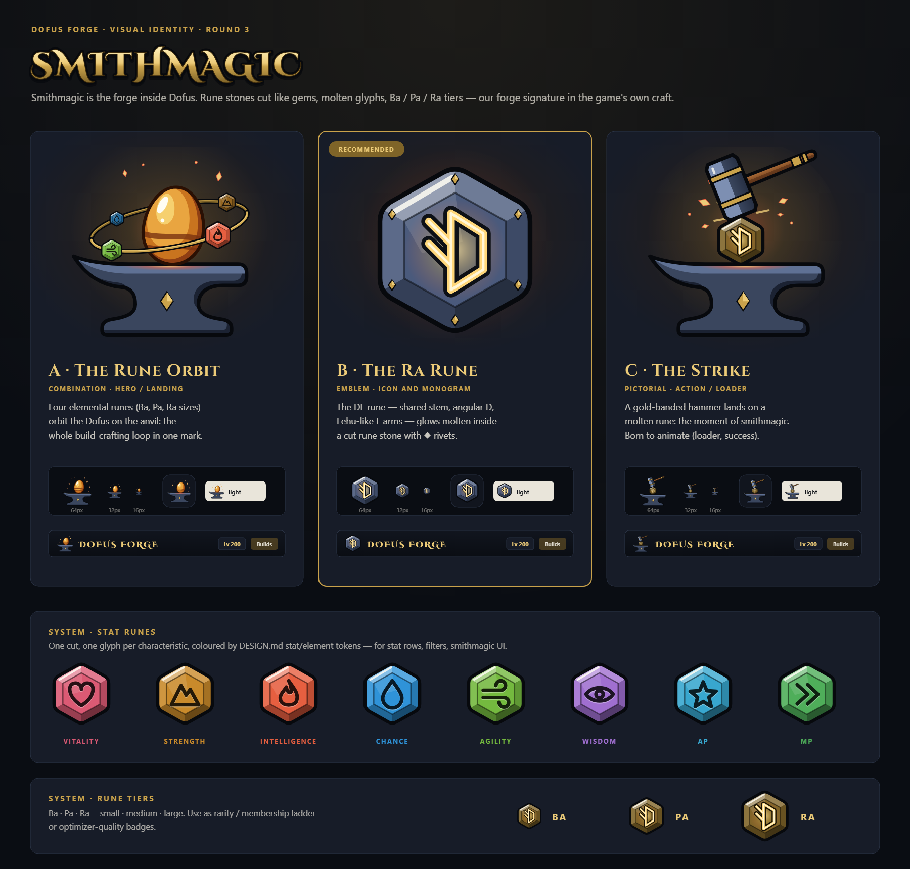
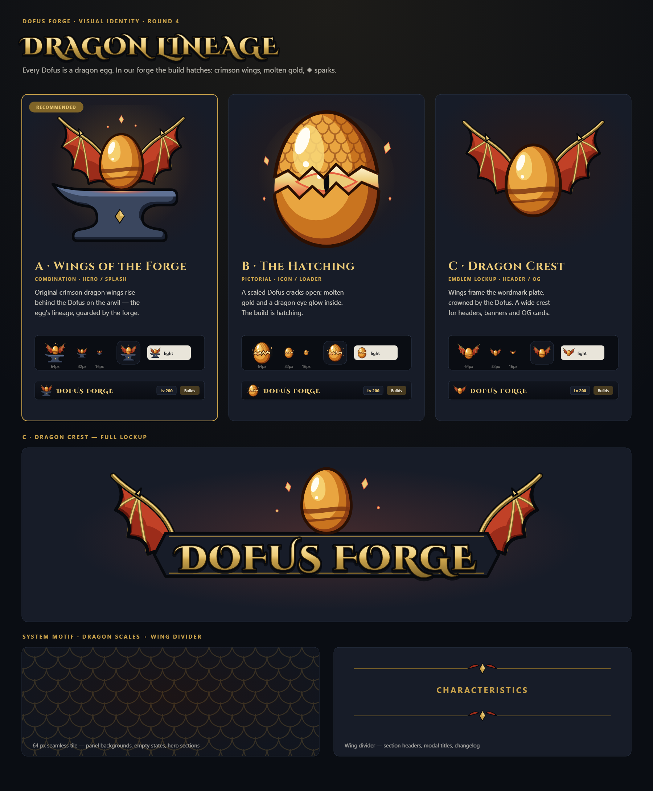
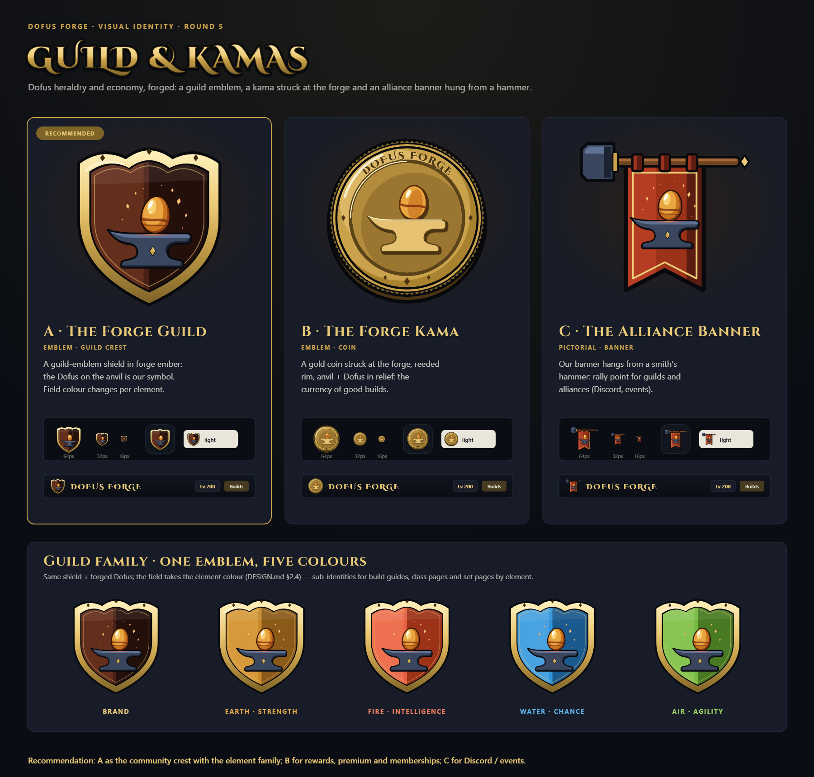
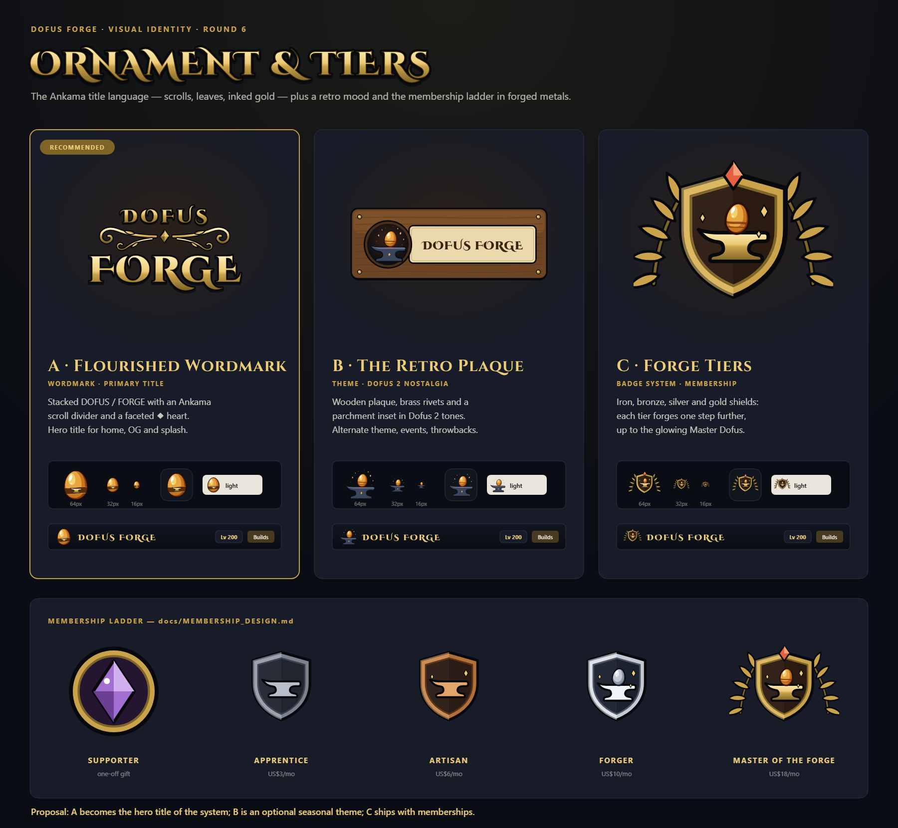

# Dofus Forge — Visual identity

Running log of the brand identity work. Every concept round lives in its own folder, including the rejected ones, together with the feedback it got and the decisions it led to. Nothing gets deleted.

- **Brief:** [BRIEF.md](BRIEF.md). Positioning: *look like Dofus, own the forge*.
- **UI design system:** [../DESIGN.md](../DESIGN.md) — The Vault palette, element colours, Cinzel.
- **Source:** [src/](src/). Every file is generated with Python + fontTools from real font outlines in [src/fonts/](src/fonts/) (SIL OFL 1.1).

## Final: The Forge Crest

The crest packs the whole site into one mark:

| Part | Stands for | From |
|---|---|---|
| Molten ◆ rune crown | Magesmithy, plus the header diamond | R3 |
| Dragon wings | Dofus lore: every Dofus is a dragon egg | R4 |
| Hex rune socket | Shared container for every icon and stat rune | R3 · R7 |
| The Dofus on the anvil | The Builder: your build is forged here | R2 |
| Four element runes | Strength · Agility · Chance · Intelligence | R3 · DESIGN §2.4 |
| ◆ sparks + dragon scales | The forge signature | R2 · R4 |
| Flourished wordmark | Ankama title language in Cinzel Decorative Black | R6 |

**Uses:**
- **Crest:** hero, OG card, splash
- **Horizontal lockup:** headers
- **Compact icon:** favicon, PWA, Discord
- **16 px cut:** browser tab

### System

The system pieces:
- Palette
- Typography: Cinzel Decorative for the logo and hero titles, Cinzel for section headers, Inter for UI text, JetBrains Mono for every number
- 10 feature sigils (Builder, The Forger, Magesmithy, Sets, Spells, Ranks & PvP, Compare, Explore, Element guides, Collections)
- 8 stat runes
- Element crests
- Membership tiers
- Motifs: scale tile, wing divider, scroll

**Rule:** every surface carries at least one forge signature — molten gold, the anvil, ◆ sparks, or the void + gold palette.

### Applications

### Kit — `public/brand/`

Generate the kit with `python docs/brand/src/export_kit.py`. It also rewrites the root favicons, apple-touch, Discord and OG files.

The app reads every path from [`src/data/brand.ts`](../../src/data/brand.ts). To swap the logo, either:
- regenerate the kit, or
- replace files using the same names.

`/brand/*` is not cached as immutable, so replaced files are served on the next request.

| File | Use |
|---|---|
| `crest.svg`, `crest-glow.svg`, `crest-{256,512,1024,2048}.png` | Master crest (transparent / with glow) |
| `logo-hero.svg`, `logo-hero-{1024,2048}.png` | Crest + stacked flourished wordmark |
| `logo-horizontal.svg`, `logo-horizontal-{600,1200,2400}.png` | Icon + wordmark, one line |
| `wordmark.svg` | Gold wordmark alone (header) |
| `icon.svg`, `icon-{48…1024}.png` | Compact icon |
| `icon-small.svg`, `icon-{16,32}.png` | Simplified cut for 16–32 px |
| `icon-maskable.svg`, `icon-maskable-512.png` | PWA maskable (safe zone) |
| `og-image.svg/.png/.jpg` | Social card, 1200×630 |
| `/favicon.svg`, `/favicon.ico`, `/favicon-{48,192,512}.png`, `/apple-touch-icon.png`, `/discord-bot-icon.png`, `/og-preview.jpg` | Root files requested by convention |

## Rounds

| Round | Direction | Status | Kept in the final |
|---|---|---|---|
| [R1](rounds/r1-geometric/) | Flat geometric marks | ❌ Rejected | — |
| [R2](rounds/r2-dofus-forge/) | Dofus × Forge, Ankama cel shading | ✅ Base | Dofus on the anvil, wordmark face, ◆ sparks, elemental Dofus |
| [R3](rounds/r3-smithmagic/) | Smithmagic runes | ✅ | Hex rune stone, stat runes, Ba/Pa/Ra tiers, The Strike (loader) |
| [R4](rounds/r4-dragon-lineage/) | Dragon lineage | ✅ | Wings, scale tile, wing divider |
| [R5](rounds/r5-guild-kamas/) | Guild & kamas | ✅ | Element crests, Forge Kama (What's New / rewards) |
| [R6](rounds/r6-ornament-tiers/) | Ornament & tiers | ✅ | Flourished wordmark, membership tier badges, retro plaque theme |
| [R7](rounds/r7-forge-system/) | The Forge System | ✅ Final | Master crest, feature sigils, kit |

### R1 — Geometric · ❌

Faceted gem egg, F-hammer, anvil + ◆.

**Feedback:** "horrible" — it doesn't feel like Dofus.

**Learned:**
- Show concepts in full colour on the site's dark palette.
- Use the game's visual language, not tech geometry.

### R2 — Dofus × Forge

**Feedback:** the egg works, but "it has nothing of Dofus yet". The ask was more rounds combining the Dofus universe, so the site gets several sub-identities. Resembling the game is desired, as long as our own identity stays distinct from other fan sites.

### R3 — Smithmagic

### R4 — Dragon Lineage

### R5 — Guild & Kamas

### R6 — Ornament & Tiers

## Open items

- **Apply the system in the UI.** Pieces still to bring in:
  - stat runes in characteristics and filters
  - feature sigils in navigation
  - element crests on guides
  - tier badges with memberships
  - The Strike as the loader
- **One-colour (flat) cut of the crest**, for print and engraving. The hero art relies on gradients and clip-paths.
- **Trademark check.** "Dofus" and the Dofus eggs belong to Ankama, so the fan-site disclaimer stays visible.
