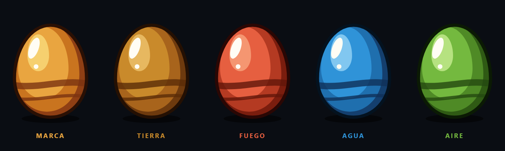
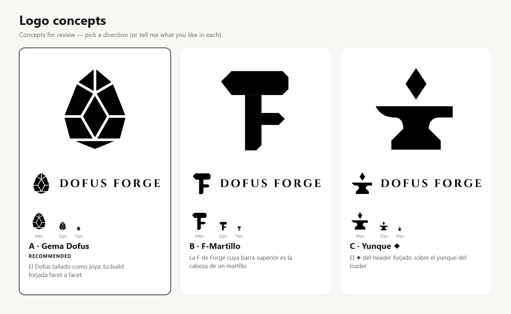

# Dofus Forge — Identidad visual

Bitácora de la identidad de marca: cada ronda de conceptos (incluidas las descartadas), el feedback recibido y las decisiones tomadas. Nada se borra; cada ronda vive en su carpeta.

- **Brief:** [BRIEF.md](BRIEF.md)
- **Fuente de verdad del sistema UI:** [../DESIGN.md](../DESIGN.md) (paleta The Vault, elementos, Cinzel)
- **Código:** [src/](src/) — todo se genera con Python + fontTools a partir de las fuentes en [src/fonts/](src/fonts/) (SIL OFL 1.1)

## Estado

| Ronda | Dirección | Estado |
|---|---|---|
| [R1](rounds/r1-geometrico/) | Geométrico minimalista (gema facetada, F-martillo, yunque ◆) | ❌ Descartada |
| [R2](rounds/r2-dofus-forja/) | Dofus × Forja, cel-shading estilo Ankama | 🟡 En revisión |

---

## R2 — Dofus × Forja · 2026-10-31

**Idea:** el Dofus nace en la forja; tu build se forja como un huevo legendario.

**Lenguaje visual:**
- **Cel-shading estilo Ankama:** contorno oscuro grueso, sombra de borde duro, brillo en forma de riñón y franjas de Dofus. No usa degradados blandos de "app".
- **Paleta The Vault** (DESIGN.md §2): acero `--metal-edge-strong`, oro `--gold`/`--gold-bright`, fondo `--surface-void`. El brillo incandescente usa `--fire`.
- **Chispas ◆:** heredan el rombo del logo del header.
- **Wordmark:** Cinzel Decorative Black (de la familia Cinzel del DESIGN.md §3). Lleva tratamiento de título de juego: sombra, contorno oscuro y oro biselado. Elegida frente a Cinzel 900 y Decorative Bold: [estudio](rounds/r2-dofus-forja/png/wordmark-study.png).

| | Concepto | Rol propuesto |
|---|---|---|
| **A** | **El Dofus en la Forja**: Dofus ocre incandescente sobre yunque con ◆ incrustado | Símbolo principal, header, lockups |
| **B** | **Sello de la Forja**: medallón de oro, 12 remaches ◆, cinta roja con el nombre en arco | Insignia premium: OG, Discord, logros, "Novedades" |
| **C** | **Dofus Blasonado**: el Dofus como escudo, con un yunque de oro en su franja | Favicon / app icon (máxima lectura a 16 px) |

Lockups: [horizontal](rounds/r2-dofus-forja/png/a-lockup-h.png) · [apilado](rounds/r2-dofus-forja/png/a-lockup-v.png)

**Adelanto del sistema:** los Dofus elementales con los colores sagrados de DESIGN.md §2.4. Sirven para íconos de sección, estados vacíos, loaders y patrones.

**Recomendación:** no elegir uno solo y usar los tres como un único sistema en tres escalas: A principal, C ícono, B sello.

**Pendiente antes del kit:**
- Versión plana a una tinta de A: hoy el hueco entre huevo y yunque es blanco. Hay que recortarlo con evenodd para que funcione sobre cualquier fondo.
- Corte de A para tamaños chicos.
- Búsqueda de marca: "Dofus" es marca de Ankama, así que hay que mantener visible el aviso de fan site.

---

## R1 — Geométrico · 2026-10-31 · ❌ descartada

Tres marcas planas y geométricas: huevo facetado como gema, una F cuya barra es un martillo y un yunque con un ◆.

**Feedback:** "están horribles". No se sienten Dofus. Lo que se pide es estilo del juego mezclado con la forja/yunque, y una identidad completa "hiper mega premium", no un logo minimalista de startup.

**Aprendizaje:**
- Mostrar a color sobre la paleta real del sitio, nunca en gris.
- Lenguaje del juego (orgánico, contorno, brillo), no geometría tech.
