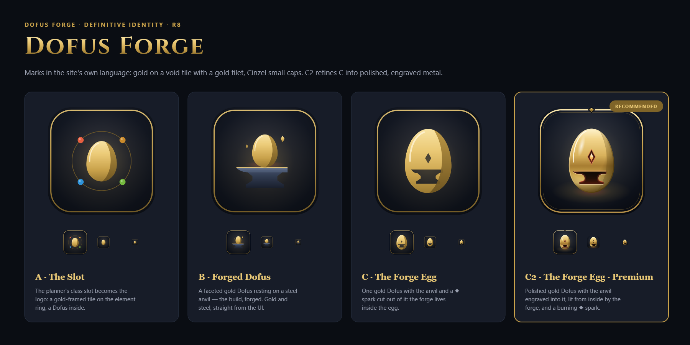
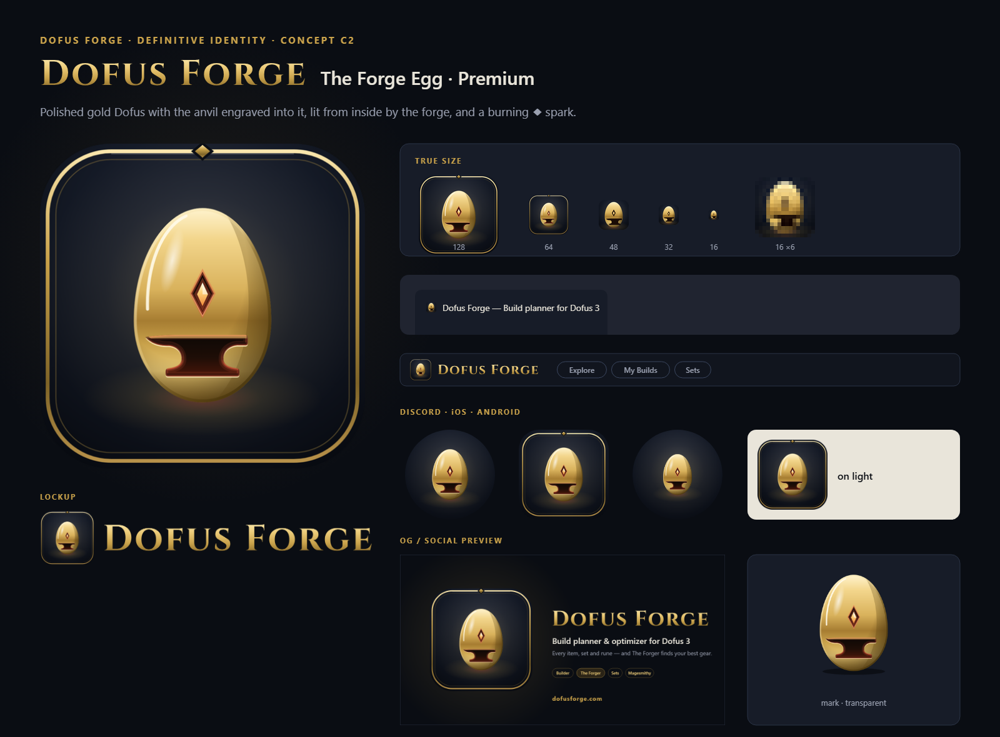

# Dofus Forge — Definitive identity (R8)



This is the definitive brand folder. Rounds R1–R7 in [`../rounds/`](../rounds/) are history only.

## Why R8 starts over

The site's UI is refined dark-luxe:
- void background and thin `--metal-edge` borders
- rounded cards
- gold Cinzel titles in small caps
- gold-outlined chips
- a glowing gold frame around the planner's slots

R2–R7 drew cel-shaded, thick-outlined cartoon marks, and they clashed with that UI.

The marks that work for companion apps follow one pattern:
- one bold, simple symbol on a solid tile
- readable at 16 px
- the detail stays in the illustrations, not in the logo

R8 applies that pattern with the site's own materials.

## Visual language

| Element | Rule | From the site |
|---|---|---|
| Symbol | Flat gold in three tones (light, body, shade facet) with a thin rim light. No outlines | `--gold-bright` / `--gold` / `--gold-deep` |
| Container | Void tile, gold glow, gold hairline border | The planner's class and equipment slots |
| Steel | `--metal-edge-strong` gradient, gold top edge | Panel borders, the anvil on the Forger guide |
| Wordmark | Cinzel small caps, gold gradient | Every page title ("About Dofus Forge", "The Forger") |
| Accents | Element colours, only where they mean an element | DESIGN.md §2.4 |

## Concepts

| | Concept | Idea |
|---|---|---|
| A | [The Slot](concepts/a-the-slot/board.png) | The planner's class slot becomes the logo: a Dofus on the element ring |
| B | [Forged Dofus](concepts/b-forged-dofus/board.png) | A faceted gold Dofus resting on a steel anvil |
| C | [The Forge Egg](concepts/c-forge-egg/board.png) | One gold Dofus with the anvil and a ◆ spark cut out of it: the forge lives inside the egg |
| **C2** | **[The Forge Egg · Premium](concepts/c2-forge-egg-premium/board.png)** — applied | C refined: polished gold with a horizon reflection, inner bevel and specular, the anvil engraved and lit from inside by the forge, a molten ◆ set like a gem; jewel tile with a double gold filet and a ◆ on its top edge |

**Why C (chosen by the user), refined into C2:**
- It has the strongest silhouette: an egg reads at 16 px, where A's ring and B's anvil disappear.
- It is the only one that needs no container to be recognised.
- It tells the whole story in one shape: Dofus, forge, spark.

**C2 adds** what makes it premium without losing the 16 px silhouette:
- polished metal instead of flat gold
- an engraved, forge-lit anvil
- the spark as a gem set in gold
- the jewel tile

Below 48 px it switches to a borderless cut, so the egg fills the tile.



## Kit per concept — `concepts/<id>/`

| File | Use |
|---|---|
| `svg/mark.svg`, `png/mark-{256,512,1024}.png` | Symbol, transparent |
| `svg/app-icon.svg`, `png/favicon-{64…1024}.png` | App icon tile |
| `svg/favicon.svg`, `png/favicon-{16,32,48}.png`, `favicon.ico` | Browser tab (16/32/48 cut) |
| `png/apple-touch-icon.png` | iOS home screen (180, opaque — iOS rounds it) |
| `png/discord-bot-icon.png` | Discord bot avatar (512, safe inside the circle crop) |
| `svg/app-icon-maskable.svg`, `png/app-icon-maskable-512.png` | Android / PWA maskable |
| `svg/lockup-horizontal.svg`, `png/lockup-horizontal-{600,1200}.png` | Icon + wordmark |
| `svg/wordmark.svg` | Wordmark alone |
| `svg/og-preview.svg`, `png/og-preview.{png,jpg}` | Social preview, 1200×630 |
| `svg/404-emblem.svg` | Inline emblem for `public/404.html` |
| `board.png` | Presentation board with every asset in context |

## Build, swap, apply

```bash
python docs/brand/dofus-forge/build.py              # rebuild all concepts + overview
python docs/brand/dofus-forge/build.py --apply c2   # put concept c2 on the site
```

`--apply` writes these files:
- the root favicons (`favicon.svg/.ico`, `favicon-48/192/512.png`)
- `apple-touch-icon.png`, `discord-bot-icon.png` and `og-preview.jpg`
- the header assets in `public/brand/`
- the emblem between the `<!-- brand:emblem -->` markers in `public/404.html`

The app reads every path from [`src/data/brand.ts`](../../../src/data/brand.ts). If the wordmark changes, update `wordmarkAspect` there; `--apply` prints the value.

Requirements:
- Python 3 with fontTools and Pillow
- the logo-design skill's `render_png.py`, which renders through headless Chrome
- the Cinzel font, from [`../src/fonts/`](../src/fonts/) (SIL OFL 1.1)

## Notes

- **Trademark.** "Dofus" and the Dofus eggs belong to Ankama. The mark evokes an egg but copies no official asset, and the fan-site disclaimer stays visible.
- **Discord.** The bot avatar is uploaded by hand in the Discord developer portal, so the file in `public/` is only the source.
