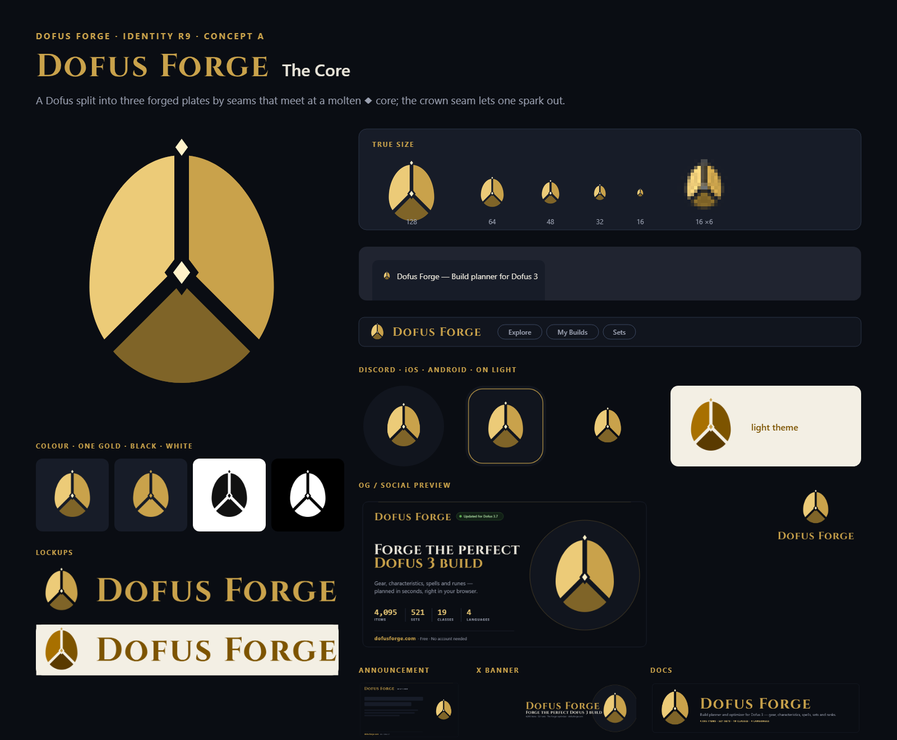
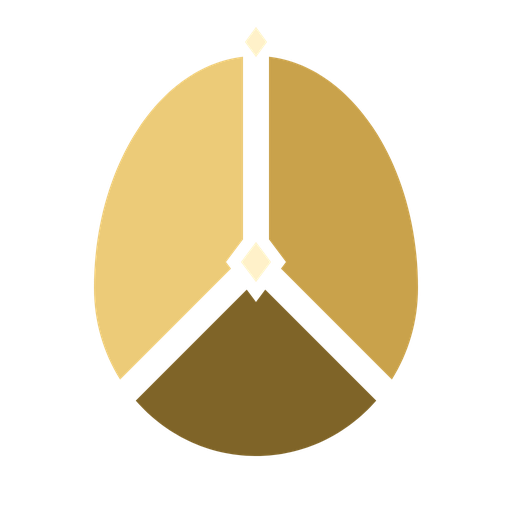
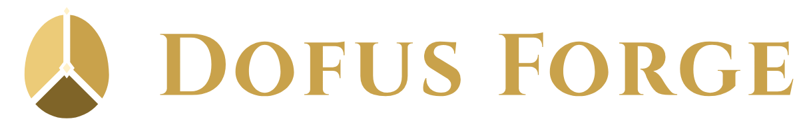
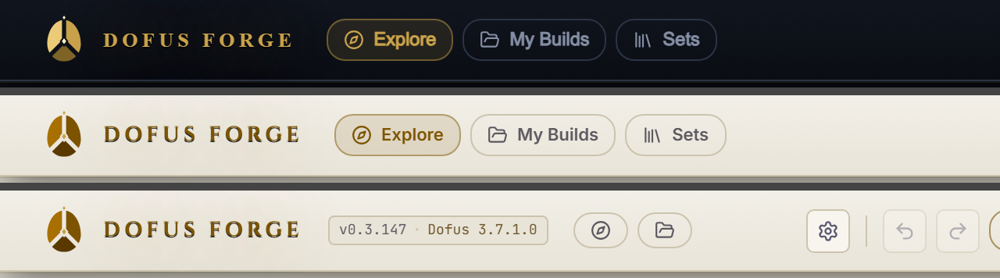

# Dofus Forge — Brand identity (R9)



This is the definitive brand folder. R1–R8 in [`../rounds/`](../rounds/) are history: R8 (Molten Dofus,
[`../rounds/r8-forge-egg/`](../rounds/r8-forge-egg/)) is the identity this one replaces.

- [colors.md](colors.md) — the palette, with roles and rules
- [typography.md](typography.md) — families, the wordmark construction, lockups, minimum sizes
- `marks.py` — the marks as exact geometry · `build.py` — the kit, the boards and `--apply`

## Why R9 replaces R8

R8's Molten Dofus told the right story (the forge bursting out of a Dofus) but told it as an illustration:
hammered iron, four glowing seams, a white-hot anvil, rim light, embers, a gold stand. Measured against what a
logo has to do, it failed four tests:

| Test | R8 | R9 |
|---|---|---|
| 16 px | a gold smudge with a bright dot | an egg, a dark Y, a cup, a light |
| One colour | impossible (16 gradients, clip paths) | one path per plate, any single colour |
| Light background | needed its own dark tile | the same plates in the light theme's golds |
| Ownable idea | "an egg with cracks" could be any fantasy app | the ◆ core and the spark are ours; the three plates are the site's faceting rule |

The site's own icons (`src/ui/slotIcons.ts`) had already set the rule: flat silhouette, lit facets, no
outline, no gradient. The logo now follows the rule the icons follow.

## Creative direction

**Positioning:** *look like Dofus, own the forge* (BRIEF.md). The Dofus is the silhouette; the forge is what
happens inside it.

**Idea in one sentence:** a Dofus is forged, not hatched — three plates joined at a molten core, and the heat
escaping through the crown is the build leaving the forge.

**Adjectives → visual cues**

| Adjective | Cue |
|---|---|
| Forged | plates and seams, not a smooth shell |
| Precise | exact geometry: 45° seams, a 24-unit grid, Béziers split at the intersection |
| Premium | three flat golds, generous negative space, nothing drawn that doesn't carry meaning |
| Of the game | the Dofus silhouette, pointed at the crown and round at the base, drawn from our own curve |
| Technical | the mark is data: 31 anchors, four fills, 764 bytes, and the header draws it from path data |

**Clichés avoided:** hammer, anvil, crossed tools, flames, shields, swords, the 4-point AI sparkle, neon gradients,
and anything traced from Ankama. The anvil stays only in the loader animation, where it is a verb, not a logo.

## The mark — Concept A, *The Core*



**Construction** (`marks.py` → `core()`, 512 box):

- One egg curve (four cubics, widest at 58 % of the height) — the Dofus.
- Three plates cut from it by seams of empty space, 26 units wide (5 % of the box): a vertical seam from the
  crown down, two seams at exactly 45° from the junction to the lower rim. The curves are split analytically at
  each intersection, so every plate is a clean closed path.
- At the junction a diamond socket (60 × 80) is cut out of all three plates, and a ◆ (30 × 40) sits inside it:
  the molten core, with a ring of void around it so it reads in one colour too.
- Above the crown, where the vertical seam exits, one ◆ spark (22 × 30) floats one seam-width clear of the egg.
- Tones, light from the upper left: lit plate `#eccb78`, body plate `#c9a24b`, shade plate `#7f6428` (the
  crucible), core and spark `#fff1c9`. The same lit/base rule as the slot icons.

**Small cut** (`favicon.svg`, ≤ 48 px): seams 40 wide, socket 84 × 112, bolder spark. Used for the favicon,
the 404 emblem and the header component.

**Readings we checked:** the three-seam junction can recall a Mercedes star or a peace sign; the egg silhouette,
the socketed core and the spark pull it away from both, and 45° (not 60°) keeps the arms from forming the
120° star. At 16 px it reads as an egg with a dark Y and a light at the centre. Mirrored and rotated it shows
nothing unintended.

**Variants:** `mark.svg` (colour, transparent) · `mark-light.svg` (light-theme golds) · `mark-mono.svg` (one gold)
· `mark-black.svg` · `mark-white.svg` · `favicon.svg` (small cut) · `app-icon.svg` (stone tile with a gold
hairline, the planner's slot) · `app-icon-square.svg` (iOS) · `app-icon-maskable.svg` (Android, 52 % safe zone).

### The two other concepts

| | Concept | Idea | Why not |
|---|---|---|---|
| B | [Circle of Six](concepts/b-circle-of-six/board.png) | Six Dofus around one ◆: the complete build | Deeply Dofus, but as a shape it is a rosette, the most generic abstract-mark form; at 16 px it is six dots |
| C | [The Hatch](concepts/c-the-hatch/board.png) | The Dofus opens on a slanted seam; the light inside is a ◆ | Clean and quiet, but it says "hatch", not "forge", and the slanted band reads as an Easter egg |

Every concept has a full kit in `concepts/<id>/`; `build.py --apply b` swaps the site to it in one command.

## Wordmark and lockups

See [typography.md](typography.md). Cinzel 700 small caps, set as outlines, with both small-cap o's redrawn as a
Dofus with Cinzel's own stroke contrast. Horizontal lockup (mark : cap height = 256 : 118), stacked lockup,
wordmark alone; each in colour, light, one gold, black and white.



## Graphic language

| Element | Rule |
|---|---|
| **The slot** | A rounded square (22 % radius) in `--surface-stone` with a 1 px `--gold` hairline inset: the planner's tile, the app icon, the frame of every card |
| **The ◆** | The one ornament. Bullet, divider, the core of the mark, the ElementGem shape in the stats; never more than one per line of text |
| **Facets** | Any icon is a flat silhouette at 55 % plus lit facets at 100 %, light from the upper left (`SlotIcon`) |
| **Seams** | Dividers are empty space or a 1 px `--metal-edge` rule, never a gradient line |
| **Rules** | Gold hairline at 35–40 % opacity along the top edge of a card (`og()` and the header) |
| **Backgrounds** | Flat void or stone. Glow is interaction feedback (`--glow-gold`), not decoration |
| **Element colours** | Game semantics only; never on the mark |

## Applications in the kit — `concepts/a-the-core/`

| File | Use |
|---|---|
| `svg/mark*.svg`, `png/mark-{256,512,1024}.png`, `png/mark-{light,mono,black,white}-512.png` | The symbol |
| `svg/favicon.svg`, `png/favicon-{16…1024}.png`, `favicon.ico` | Browser tab (16/32/48 = small cut), PWA |
| `svg/app-icon*.svg`, `png/app-icon-512.png`, `png/apple-touch-icon.png`, `png/app-icon-maskable-512.png` | iOS, Android, future mobile app |
| `png/discord-bot-icon.png` | Discord bot avatar |
| `svg/lockup-*.svg`, `png/lockup-*.png`, `svg/wordmark*.svg`, `png/wordmark-1200.png` | Lockups and wordmark |
| `svg/og-preview-{en,es,fr,pt}.svg`, `png/og-preview-{lang}.{png,jpg}` | Social preview per language, 1200 × 630, with real numbers from `public/data` |
| `social/x-avatar-400.png`, `social/x-banner-1500x500.png` | X profile |
| `social/discord-server-icon-512.png`, `social/discord-server-banner-960x540.png` | Discord server |
| `social/announcement-1200x675.png` | Announcement frame for Discord/X posts (title area left blank) |
| `social/docs-banner-1280x320.png` | Documentation header |
| `svg/404-emblem.svg` | Inline emblem for `public/404.html` |
| `board.png` | Presentation board |

Generated share cards keep working unchanged: the Worker draws `/brand/mark-256.png` on set, class and build
cards (`src/worker/ogPages.ts`, `ogImage.ts`), and the export card draws it too.

## Build, swap, apply

```bash
python docs/brand/dofus-forge/build.py              # rebuild all concepts + overview
python docs/brand/dofus-forge/build.py a --apply a  # put concept a on the site
```

`--apply` writes:
- the root favicons (`favicon.svg/.ico`, `favicon-48/192/512.png`), `apple-touch-icon.png`, `discord-bot-icon.png`, `og-preview.jpg`
- the header and share assets in `public/brand/`
- the emblem between the `<!-- brand:emblem -->` markers in `public/404.html`
- `src/ui/brandMarkData.ts`: the small cut as path data, which `src/ui/BrandMark.tsx` draws inline in the header and
  the planner with the theme's golds (`--gold-bright`, `--gold`, `--gold-deep`, `--brand-hot`), so the mark
  follows the light theme and costs no image request

The app reads every path from [`src/data/brand.ts`](../../../src/data/brand.ts).



Requirements: Python 3 with fontTools and Pillow, the logo-design skill's `render_png.py` (headless Chrome), and
the Cinzel font from [`../src/fonts/`](../src/fonts/) (SIL OFL 1.1).

## Post-deploy checklist (after dev → main)

1. **Cloudflare:** Caching → Purge everything, or purge `/favicon*`, `/apple-touch-icon.png`, `/og-preview.jpg` and `/brand/*`.
2. **Discord bot:** Developer Portal → your app → Bot → upload `public/discord-bot-icon.png`.
3. **Discord server:** Server Settings → Overview → upload `social/discord-server-icon-512.png` and the banner.
4. **X:** upload `social/x-avatar-400.png` and `social/x-banner-1500x500.png`.
5. **Re-scrape previews:** Facebook Sharing Debugger on `/`, `/es`, `/fr`, `/pt`; post a link on X; Discord picks up the new card on the next message.
6. **Browsers:** a cached favicon can stick for days; Ctrl+F5 shows the new one.

## Notes and limits

- **Trademark.** "Dofus" and the Dofus eggs belong to Ankama. The mark evokes an egg with our own curve and
  copies no official asset; the fan-site disclaimer stays visible. No trademark search was run.
- **Fonts.** Cinzel (SIL OFL 1.1) allows logo use; the wordmark ships as outlines only.
- **Strokes.** The app-icon hairline is the only stroke in the kit; every mark is fills only.
- **Masters.** SVG only. No AI/EPS/PDF masters were produced.
