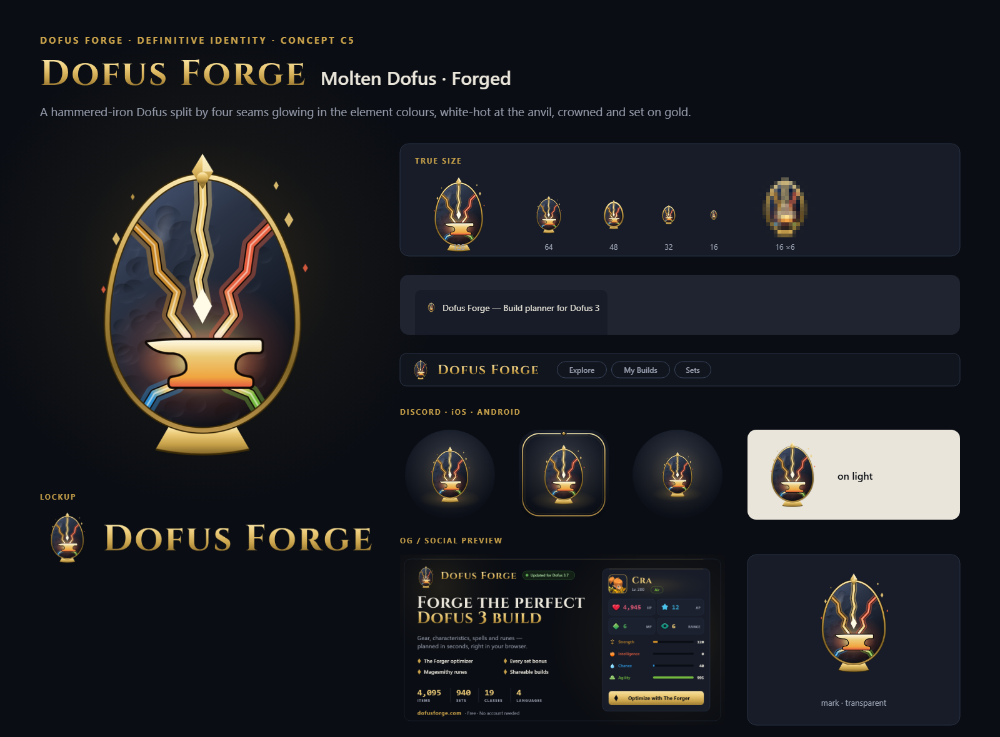
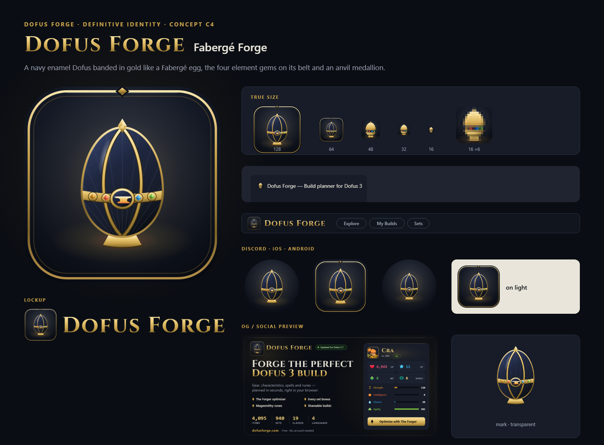

# Dofus Forge — Definitive identity (R8)


This is the definitive brand folder. Rounds R1–R7 in [`../rounds/`](../rounds/) are history only.

## Why R8 starts over

The site's UI is refined dark-luxe:
- void background and thin `--metal-edge` borders
- rounded cards
- gold Cinzel titles in small caps
- gold-outlined chips
- a glowing gold frame around the planner's slots

R2–R7 drew cel-shaded, thick-outlined cartoon marks, and they clashed with that UI.

The marks that work for companion apps follow one pattern:
- one bold, simple symbol on a solid tile
- readable at 16 px
- the detail stays in the illustrations, not in the logo

R8 applies that pattern with the site's own materials.

## Visual language

| Element | Rule | From the site |
|---|---|---|
| Symbol | Flat gold in three tones (light, body, shade facet) with a thin rim light. No outlines | `--gold-bright` / `--gold` / `--gold-deep` |
| Container | Void tile, gold glow, gold hairline border | The planner's class and equipment slots |
| Steel | `--metal-edge-strong` gradient, gold top edge | Panel borders, the anvil on the Forger guide |
| Wordmark | Cinzel small caps, gold gradient | Every page title ("About Dofus Forge", "The Forger") |
| Accents | Element colours, only where they mean an element | DESIGN.md §2.4 |

## Concepts

| | Concept | Idea |
|---|---|---|
| A | [The Slot](concepts/a-the-slot/board.png) | The planner's class slot becomes the logo: a Dofus on the element ring |
| B | [Forged Dofus](concepts/b-forged-dofus/board.png) | A faceted gold Dofus resting on a steel anvil |
| C | [The Forge Egg](concepts/c-forge-egg/board.png) | One gold Dofus with the anvil and a ◆ spark cut out of it: the forge lives inside the egg |
| C2 | [The Forge Egg · Premium](concepts/c2-forge-egg-premium/board.png) | C refined: polished gold, engraved forge-lit anvil, molten ◆ set like a gem, jewel tile |
| C3 | [Molten Dofus](concepts/c3-molten-dofus/board.png) | A dark steel Dofus split by molten gold seams that burst from a white-hot anvil inside it |
| C4 | [Fabergé Forge](concepts/c4-faberge-forge/board.png) | A navy enamel Dofus with guilloché, banded in gold like a Fabergé egg; the four element gems on its belt, an anvil medallion, a ◆ finial and a gold stand |
| **C5** | **[Molten Dofus · Forged](concepts/c5-molten-forged/board.png)** — applied | C3 completed: a hammered-iron Dofus split by four seams, each glowing in its element colour (earth, fire, water, air) and white-hot where it meets the anvil; a crown seam up to a gold ◆ finial, a gold rim and stand, rising ◆ embers |

**From C to C4.** The user picked The Forge Egg (C). C2 made it more premium, but a gold egg on a dark tile still read as a generic app icon.

**C3 → C5.** The user liked C3 (the forge bursting out of the Dofus) but felt something was missing. Four things were:
- the cracks read as random lightning rather than craft
- the steel read as glass
- there was no premium structure
- none of the page's colours appeared except gold

**C5 adds:**
- **Forged material.** Hammered iron in `--metal-edge-strong` → `--surface-panel` → `--surface-void`, with dents and an inner forge glow.
- **One seam per element.** Each uses the DESIGN.md colour, so the four elements are literally being forged into the Dofus. Kintsugi logic: the cracks are filled with molten metal.
- **Gold structure.** The ◆ finial, rim and stand carry over from C4: jewellery, not clip-art.
- **Small cut (≤48 px).** A thick gold rim, fatter seams and the white-hot anvil.
- **No frame where the silhouette carries it.** The favicon, header icon, logo, lockup, OG and 404 show the egg and its stand alone. The dark tile stays only for apple-touch, Android/PWA and the Discord bot, whose platforms crop to a square or circle (`bare=True` in `build.py`).



<details><summary>C4 · Fabergé Forge</summary>



</details>

## Kit per concept — `concepts/<id>/`

| File | Use |
|---|---|
| `svg/mark.svg`, `png/mark-{256,512,1024}.png` | Symbol, transparent |
| `svg/app-icon.svg`, `png/favicon-{64…1024}.png` | App icon tile (`public/brand/app-icon.svg`) |
| `svg/favicon.svg`, `png/favicon-{16,32,48}.png`, `favicon.ico` | Browser tab (16/32/48 cut) |
| `png/apple-touch-icon.png` | iOS home screen (180, opaque — iOS rounds it) |
| `png/discord-bot-icon.png` | Discord bot avatar (512, safe inside the circle crop) |
| `svg/app-icon-maskable.svg`, `png/app-icon-maskable-512.png` | Android / PWA maskable |
| `svg/lockup-horizontal.svg`, `png/lockup-horizontal-{600,1200}.png` | Icon + wordmark |
| `svg/wordmark.svg` | Wordmark alone |
| `svg/og-preview-{en,es,fr,pt}.svg`, `png/og-preview-{lang}.{png,jpg}` | Social preview per language, 1200×630: brand row with the live game version, headline, four features, real numbers from `public/data` (items, sets, classes), and a planner card with real class/stat icons. `og-preview.*` = English |
| `svg/404-emblem.svg` | Inline emblem for `public/404.html` |
| `board.png` | Presentation board with every asset in context |

## Build, swap, apply

```bash
python docs/brand/dofus-forge/build.py              # rebuild all concepts + overview
python docs/brand/dofus-forge/build.py --apply c5   # put concept c5 on the site
```

`--apply` writes these files:
- the root favicons (`favicon.svg/.ico`, `favicon-48/192/512.png`)
- `apple-touch-icon.png`, `discord-bot-icon.png` and `og-preview.jpg`
- the header assets in `public/brand/`
- the emblem between the `<!-- brand:emblem -->` markers in `public/404.html`

The app reads every path from [`src/data/brand.ts`](../../../src/data/brand.ts). If the wordmark changes, update `wordmarkAspect` there; `--apply` prints the value.

Requirements:
- Python 3 with fontTools and Pillow
- the logo-design skill's `render_png.py`, which renders through headless Chrome
- the Cinzel font, from [`../src/fonts/`](../src/fonts/) (SIL OFL 1.1)

## Notes

- **Trademark.** "Dofus" and the Dofus eggs belong to Ankama. The mark evokes an egg but copies no official asset, and the fan-site disclaimer stays visible.
- **Discord.** The bot avatar is uploaded by hand in the Discord developer portal, so the file in `public/` is only the source.
