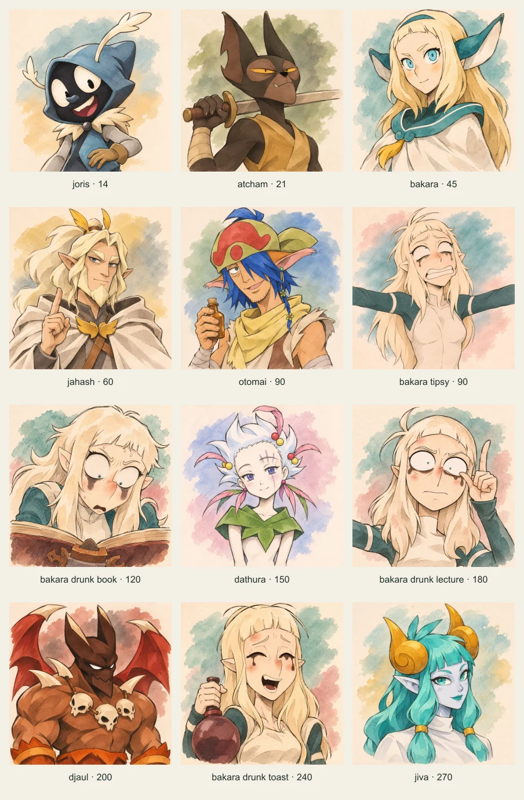
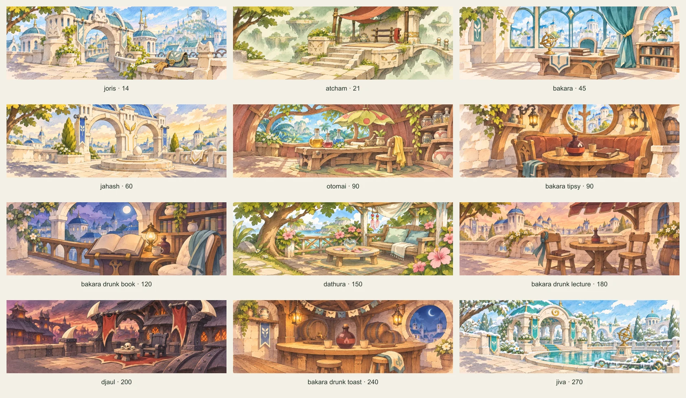
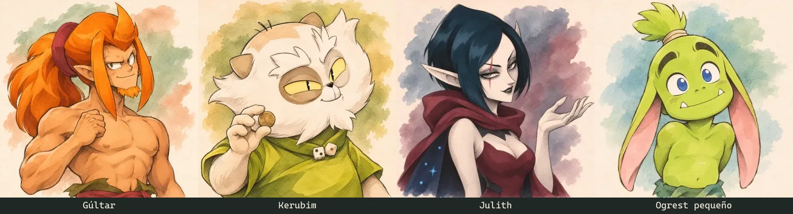
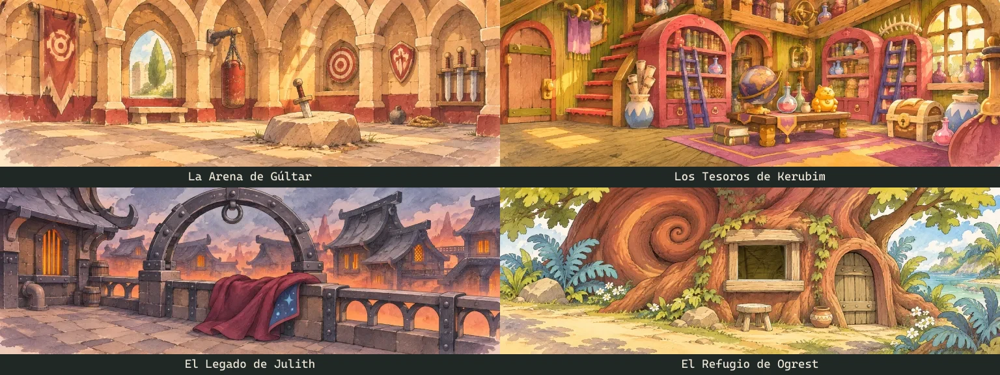
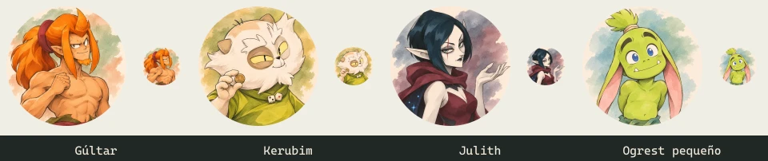

# Personajes emblemáticos — recompensas exclusivas

Colección propia de Forge de figuras emblemáticas del universo de DOFUS:
un retrato para foto de perfil y un escenario relacionado por personaje.
La primera tanda aprobada es **Gúltar, Kerubim Crepin, Julith y Ogrest pequeño**.
La corrección del usuario sustituye Bolgrot por **Ogrest en su forma pequeña**.

## Ampliación de la 0.4.28

**16 pares en total:** los cuatro originales y doce nuevos. Se añaden los ocho
personajes aprobados y cuatro momentos de Bakara borracha, elegidos todos por
el usuario. La normal va en el día 45; las opciones A/B/C/D se reparten en
90/120/180/240. Otomaï y la opción A se desbloquean juntos el día 90.

| Etapa | Día | Personaje / variante | Escenario propio de Forge |
|---|---:|---|---|
| Primeros pasos | 7 | Kerubim Crepin, original | Los Tesoros de Kerubim |
| Primeros pasos | 14 | Joris Jurgen | Los Tejados de Joris |
| Primeros pasos | 21 | Atcham Crepin | Las Pasarelas de Atcham |
| Primeros pasos | 30 | Julith, original | El Legado de Julith |
| Hazañas | 45 | Bakara normal | Los Estudios de Bakara |
| Hazañas | 60 | Jahash Jurgen | El Baluarte de Jahash |
| Hazañas | 90 | Otomaï | El Laboratorio de Otomaï |
| Hazañas | 90 | Bakara borracha A: brazos abiertos | La Noche de Bakara |
| Hazañas | 100 | Gúltar, original | La Arena de Gúltar |
| Leyendas | 120 | Bakara borracha B: el libro | Las Páginas de Bakara |
| Leyendas | 150 | Dathura | El Jardín de Dathura |
| Leyendas | 180 | Bakara borracha C: el sermón | La Terraza de Bakara |
| Leyendas | 200 | Djaul | La Sombra de Djaul |
| Leyendas | 240 | Bakara borracha D: el brindis | La Última Ronda |
| Leyendas | 270 | Jiva | Los Jardines de Jiva |
| Leyendas | 365 | Ogrest pequeño, original | El Refugio de Ogrest |

Se priorizan las **versiones de la animación**: Joris, Atcham, Bakara y Jahash
de *DOFUS, Book I: Julith* (2016); Otomaï y Dathura de *Ogrest, la légende*
(2011). Dathura conserva su forma de muñeca de pelo blanco. Djaul y la cabeza
de Jiva se verificaron en el cliente 3.7.14.18; el retrato de Jiva interpreta
su vestuario con un cuello opaco. No se atribuyen estas escenas originales
a mapas canónicos ni las formas animadas al cliente del juego.

Cada pieza nueva se inspeccionó en tamaño original y en recorte circular o
móvil. Esto registra la revisión técnica, no sustituye la aprobación visual
del usuario. El agarre de Atcham deja tres dedos curvados y pulgar claramente
legibles; no se establece un quinto. En Joris el pulgar no queda separado
con claridad; en Otomaï el frasco lo oculta en gran parte. Se conserva la
primera versión elegida para revisión, sin correcciones automáticas.

- [Prompts exactos, fuentes, hashes y observaciones de las 24 piezas nuevas](expansion-1-manifest.json).
- [Seguimiento de las 16 recompensas](expansion-1-plan.json).
- [Todas las versiones de Bakara, incluidas las anteriores y la comparativa](bakara-review/README.md).
- [Joris anterior basado en el juego](joris-portrait-archived-full.webp) y [Otomaï anterior](otomai-portrait-archived-full.webp), conservados.

Los PNG originales permanecen en las rutas locales del manifiesto. Las
versiones WebP de producción son 512 × 512 y 1920 × 640. Los marcos siguen
siendo una capa separada, con sus cuatro hitos originales 7/30/100/365.
La migración aditiva `20261127020000_expand_emblematic_streak_rewards.sql`
debe aplicarse antes de desplegar la ampliación. No cambia derechos previos,
RPC ni permisos; las 16 elecciones siguen validadas por el servidor.

La técnica es la misma tinta y acuarela de los 266 retratos de clases y
68 escenarios existentes. No se sustituye por pintura digital realista,
otro estilo de recompensa ni un marco horneado dentro de la ilustración.
Los retratos conservan el encuadre habitual de cabeza y parte superior
del torso, y cada personaje tiene pose y expresión propias.

## Seguimiento de la primera tanda

Las casillas indican **primera versión generada e inspeccionada**;
la aprobación visual del usuario y cualquier corrección se registran aparte.

| Personaje | Retrato | Escenario | Nombre del escenario |
|---|---|---|---|
| Gúltar | [x] | [x] | La Arena de Gúltar |
| Kerubim Crepin | [x] | [x] | Los Tesoros de Kerubim |
| Julith | [x] | [x] | El Legado de Julith |
| Ogrest pequeño | [x] | [x] | El Refugio de Ogrest |

Los nombres de los escenarios son **títulos propios de Forge**. La arena
de Gúltar, la terraza de Julith y el refugio infantil de Ogrest son
composiciones temáticas originales con motivos verificados; no se
presentan como mapas oficiales con esos nombres. La tienda de Kerubim
se basa en sus habitaciones reales del cliente.

## Referencias e identidad

- **Gúltar:** NPC 1216/5336, look `{7551|||155}` del cliente DOFUS
  **3.7.14.18**. Su diálogo menciona su lugar de entrenamiento; la
  arquitectura y equipo del Templo de Yopuka (mapa 183762956) sirven de
  referencia para la composición de su arena.
- **Kerubim:** NPC 1901 y 3043, looks `{2017}` y `{2841|||130}` del mismo
  cliente. Tienda y planta superior: mapas 103547392 y 103548416.
- **Julith:** monstruo 5663/NPC 6455, look `{5273|||140}`. La terraza combina
  arquitectura de Brakmar (mapas 212862209 y 212860930) con los motivos
  burdeos, azul noche y pequeñas estrellas del forro de su capa.
- **Ogrest pequeño:** referencias oficiales de Ankama, verificadas como
  **obra transmedia**, sin atribuirle un modelo del cliente 3.7:
  [Ogrest: The Legend, Ankama Animations](https://www.youtube.com/watch?v=DqUaJ8SXwRY),
  [Ogrest, tomo 1](https://www.ankama-shop.com/en/dofus/300-ogrest-volume-1.html)
  y [edición coleccionista](https://www.ankama-shop.com/fr/livres/4462-ogrest-integrale-collector-5-tomes-mig-dofus.html).
  El pequeño ogro verde, de ojos azules, orejas largas con interior rosado,
  dos pequeños colmillos y mechón atado es la forma elegida. Su refugio
  recoge la isla de infancia, el árbol y la ventana de esas referencias.
  La forma adulta y las representaciones como tofu quedan fuera de esta tanda.

Los modelos se reconstruyeron con `scripts/extract-characters.py` y el
renderer de personajes existente. Los mapas usan
`scripts/render-banner-references.py`; son reconstrucciones de planos
estáticos, con posibles máscaras de iluminación, no capturas exactas del juego.

## Archivos y revisión

- Avatares web: `public/avatars/exclusive/v1/<personaje>.webp`, **512 × 512**.
- Banners web: `public/banners/exclusive/v1/<personaje>.webp`, **1920 × 640**.
- PNG originales sin modificar: `temp/emblematic-rewards/masters/`.
- Manifiesto de esta colección: `manifest.json`, con prompts exactos,
  hashes de PNG/WebP/referencias, identidad, procedencia y observaciones.
- Se usa **image_gen integrado**; todas las primeras generaciones se conservan.
  Julith tiene una revisión más sensual y elegante, solicitada expresamente
  por el usuario; el original y ambos prompts quedan en su historial.

Inspeccionar cada retrato ampliado, en círculo a 150/48 px y con detalle de
las manos cuando haga falta; cada banner ampliado y en recortes de
escritorio/móvil. El checklist se aplica a la especie real de cada figura.
Guardar las observaciones, incluidas ambigüedades, sin corregir
automáticamente. El usuario revisa la tanda y solicita los cambios concretos.
La inspección técnica no equivale a aprobación visual del usuario.

## Observaciones para la revisión del usuario

- **Gúltar:** el pulgar no se separa por completo en la vista del puño cerrado.
- **Kerubim:** la pata que sostiene la moneda tiene cuatro siluetas de dedos claramente visibles; revisar su anatomía y tratamiento de pelaje.
- **Julith:** seleccionada la revisión más sensual y elegante solicitada por el usuario, con mirada/sonrisa y escote refinados. Se conserva la observación de la mano levantada: tres dedos largos y pulgar son inequívocos; el cuarto dedo largo sigue ambiguo entre los contornos. El original queda archivado.
- **Ogrest:** forma pequeña verificada; no hay manos expuestas en esta pose.

Se conservan todas las primeras generaciones para que el usuario indique
las correcciones. El manifiesto contiene la inspección individual de cada pieza.

## Entrega para integración

Estos archivos se preparan **fuera del catálogo y selector público normal**.
Los 266 retratos de clases y 68 banners anteriores conservan sus registros
y archivos. Los exclusivos no incrementan el progreso de los 600 rostros
de las clases y no requieren nuevas combinaciones de clase/género.

La asignación a hitos, DB, RPC, validación de derechos, guardado y conexión
con React corresponde a la tarea de integración descrita en
[el brief](../streak-rank-rewards-brief.md). No se crean umbrales ni
desbloqueos desde la producción de arte. El servidor debe verificar que
la cuenta ha desbloqueado cada pieza, además de filtrar el selector.
Los marcos de racha siguen siendo una capa CSS/SVG independiente del arte.

## Ampliar la colección

1. Añadir una figura emblemática aprobada y el concepto de su escenario
   al seguimiento. La condición de jefe de mazmorra por sí sola no decide la selección.
2. Verificar su forma, época, anatomía, vestuario y nombres. Usar el cliente
   actual donde exista el modelo; documentar la fuente oficial de Ankama
   cuando la representación sea transmedia.
3. Tomar los archivos aprobados de Forge solo como referencia de técnica
   y encuadre. Componer una pose y un escenario propios de ese personaje.
4. Guardar el prompt antes de generar, crear una primera versión por pieza
   y conservar el PNG original. Exportar WebP sin alterar su contenido.
5. Inspeccionar y anotar observaciones, añadir hashes y procedencia al
   manifiesto y marcar las casillas de producción. Esperar la revisión del
   usuario para cualquier corrección concreta.
6. Coordinar los desbloqueos con la integración; nunca añadir el exclusivo
   a la lista pública general para hacerlo visible.
