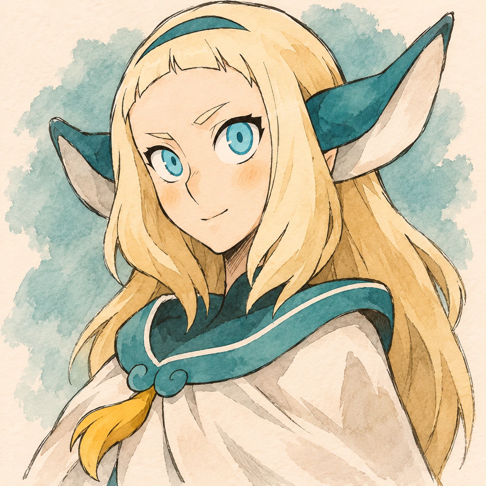
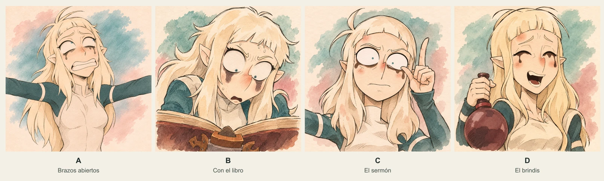

# Bakara — normal y opciones borracha

Revisión solicitada por el usuario el 2026-11-27. Antes de generar estas
opciones se contrastaron la apariencia normal y los fotogramas de la escena
borracha de **DOFUS, Livre I : Julith (2016)**. Las referencias enviadas por
el usuario tienen prioridad sobre las interpretaciones previas.

La normal conserva capa marfil, borde y diadema turquesa, cierre y pluma
dorada. Las borrachas conservan el atuendo de esa escena, sin capa ni
diadema, pelo revuelto y maquillaje corrido. Se mantiene la tinta y acuarela
y el encuadre habitual de avatar de Forge.

| Opción | Expresión | Imagen completa |
|---|---|---|
| A | Brazos abiertos, referencia elegida inicialmente por el usuario | [Ver A](bakara-animation-faithful-tipsy-full.webp) |
| B | Intentando concentrarse en el libro | [Ver B](bakara-drunk-b-full.webp) |
| C | Dando un sermón con el índice levantado | [Ver C](bakara-drunk-c-full.webp) |
| D | Riéndose y levantando la botella para brindar | [Ver D](bakara-drunk-d-full.webp) |

**El usuario eligió las cuatro opciones.** La normal corresponde a 45 días.
A se desbloquea a 90 días junto con Otomai; B a 120, C a 180 y D a 240.
Cada una conserva su propio retrato y escenario relacionado.

Todas las primeras versiones, correcciones expresamente solicitadas y
alternativas se conservan. [Manifiesto](manifest.json): prompts exactos,
fuentes, hashes y observaciones. Másteres PNG locales en
`temp/emblematic-expansion/masters/`; copias WebP completas en esta carpeta.
La revisión incluye imágenes nativas, recortes circulares a 150/48 px y
manos ampliadas de C y D. Una inspección técnica no sustituye la elección
visual del usuario.
