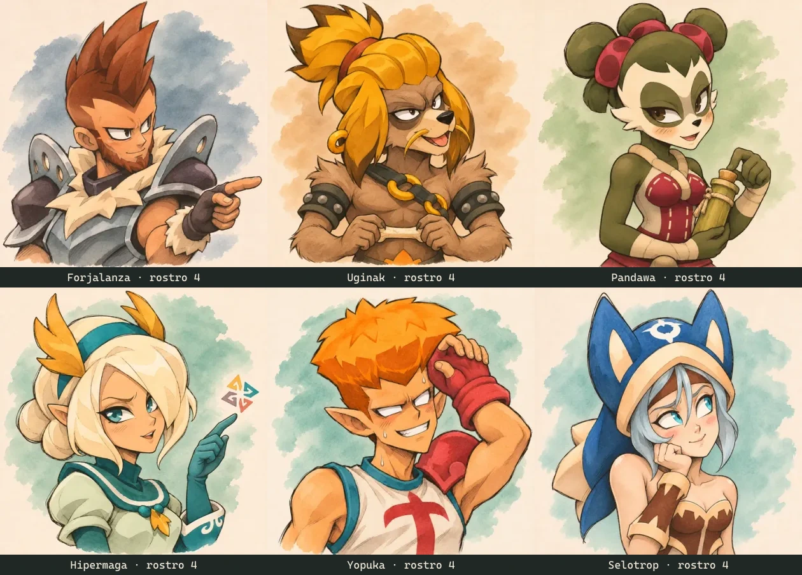
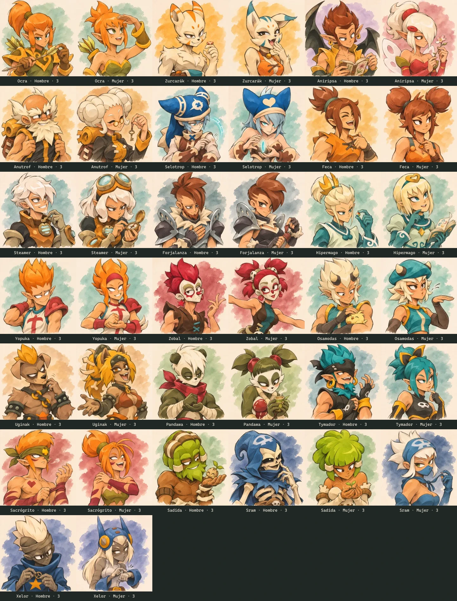
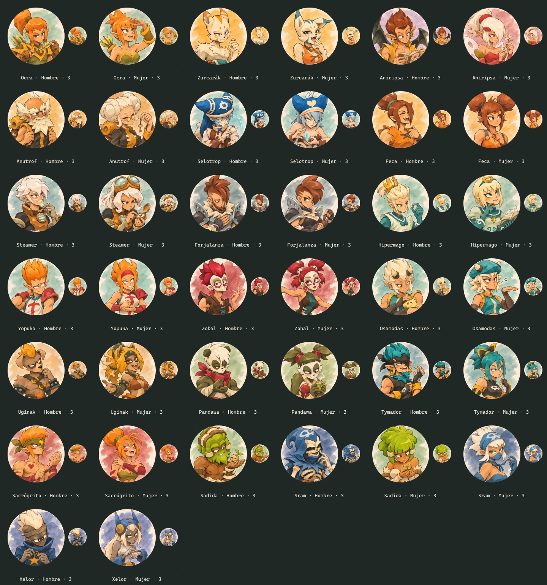
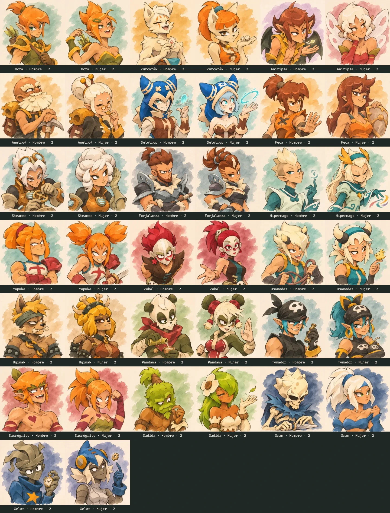
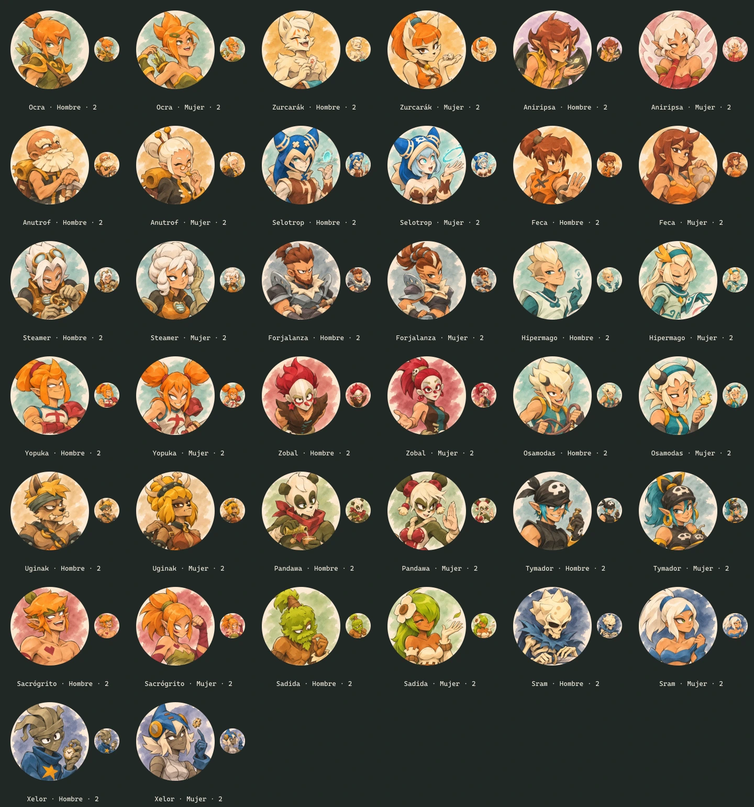

# Retratos de perfil de Forge

Colección original de fan art de las 19 clases de Dofus, basada en los modelos reales del cliente. Los primeros cuatro rostros/peinados tienen versiones masculinas y femeninas: **152 retratos** con traje habitual, poses propias y el mismo acabado de tinta y acuarela.

- [Progreso por clase, sexo y modelo](PROGRESS.md): lista completa con casillas de los rostros hechos y pendientes; los trajes alternativos van al final.
- [Inventario del juego](game-looks.json): 600 rostros/peinados y 76 cuerpos de creación, incluidos los 38 trajes habituales y los 38 alternativos reservados para después.
- [Prompts y procedencia de cada imagen](manifest.json): prompt exacto, pose, referencias, hash y `gameLook` con posición, id y textura de cabeza/cuerpo.
- [Plantilla para continuar](prompt-template.json): conservar la técnica artística y los rasgos del modelo, inventando un gesto y expresión distintos para cada retrato.

## Rostro 4

38 retratos nuevos para las 19 clases, masculino y femenino, con el cuarto rostro/peinado y el traje habitual del cliente DOFUS 3.7.14.18. Cada ilustración conserva el modelo exacto y tiene una pose propia. Los rostros anteriores siguen disponibles. El progreso actual es de 152/600 rostros terminados y 448 pendientes; los 38 trajes alternativos siguen reservados para después.

PNG originales en `temp/profile-avatars/masters/v1/<clase>-look-4-<m|f>.png`; la web usa `public/avatars/classes/v1/<clase>-look-4-<m|f>.webp` a 512 × 512 px. Cada entrada guarda el prompt exacto, pose, ids de cabeza/cuerpo, versión del cliente y hashes de las referencias y archivos finales. Dos renders del cuarto modelo establecen la identidad y el retrato aprobado aporta la técnica.

Aplicar `supabase/migrations/20261123050000_profile_art_fourth_heads_and_locations.sql` antes del despliegue. Agrega 38 retratos y ocho escenarios a los catálogos existentes, conserva perfiles y permisos, y puede repetirse. No se ha ejecutado contra la base de datos alojada desde este trabajo.

Las seis correcciones de anatomía de esta tanda conservan el prompt y PNG anteriores en `originalGeneration`, además del prompt exacto de edición y sus referencias. Se revisaron manos, lateralidad, continuidad de los dos brazos y un solo torso antes de actualizar los PNG y WebP.

## Rostro 3

38 retratos nuevos para las 19 clases, masculino y femenino, con el tercer rostro/peinado y el traje habitual del cliente DOFUS 3.7.14.18. Cada dibujo conserva su modelo exacto y tiene una pose y expresión propias. Los rostros 1 y 2 siguen disponibles. Esa tanda completó 114/600 rostros; los 38 trajes alternativos siguen reservados para después.

PNG originales: `temp/profile-avatars/masters/v1/<clase>-look-3-<m|f>.png`. La web usa `public/avatars/classes/v1/<clase>-look-3-<m|f>.webp` a 512 × 512 px. El manifiesto guarda el prompt exacto, pose, ids y texturas del modelo, versión del cliente, hashes de las referencias y hashes del PNG y WebP. La técnica se mantiene con el retrato aprobado; la identidad viene de dos renders del tercer modelo.

Antes del despliegue, aplicar `supabase/migrations/20261123040000_profile_art_third_heads_and_locations.sql`. Solo agrega 38 retratos y ocho escenarios a los catálogos existentes; conserva las fotos, portadas y permisos actuales. No se ha ejecutado en la base de datos alojada desde este trabajo.

## Rostro 2

El número identifica el rostro/peinado del juego, no una técnica artística diferente. Se usa el traje habitual; los trajes alternativos se producirán después de los rostros. La posición empieza en 1 y sigue `order` e `id` del cliente. Las etiquetas internas no siempre son consecutivas: usar los ids guardados para reproducir el modelo exacto.

Los originales PNG están en `temp/profile-avatars/masters/v1/`. La web usa WebP opaco de 512 × 512 px con el fondo de acuarela incluido. Los primeros retratos conservan `<clase>-<m|f>.webp`; los nuevos usan `<clase>-look-2-<m|f>.webp`. El recorte circular se aplica al mostrar el perfil, conservando la ilustración cuadrada completa para ampliarla.

## Continuar otra tanda

1. Ejecutar `python scripts/extract-avatar-looks.py --export-head <posición>` con el cliente del juego instalado. Exporta referencias locales y actualiza el inventario sin cambiar los modelos usados por el planificador.
2. Renderizar el rostro seleccionado desde dos ángulos con el renderer existente; observar sus diferencias. Algunos rostros cambian la máscara o eliminan la capucha/sombrero.
3. Revisar las poses existentes, elegir una nueva y generar una ilustración por sexo usando el retrato aprobado como referencia de técnica y los renders como referencia de identidad.
4. Revisar manos, silueta, rasgos del modelo y recorte circular pequeño. Guardar PNG, WebP y cada prompt exacto en el manifiesto; mantener las imágenes aprobadas anteriores.
5. Ejecutar `node scripts/sync-avatar-progress.mjs`. Solo tacha retratos con archivo, hash y prompt verificados. Los demás quedan pendientes.
6. Registrar únicamente los retratos terminados en el selector y en una migración aditiva de `profile_avatar_catalog`, reflejada en `schema.sql`. Los prompts y el progreso viven en el repositorio; la base de datos solo autoriza rutas públicas exactas.

## Publicación del rostro 2

Aplicar `supabase/migrations/20261123020000_profile_avatar_second_heads.sql` en Supabase **antes de publicar el selector ampliado**. El despliegue del frontend no ejecuta migraciones SQL. Esta migración solo agrega las 38 rutas nuevas; conserva las fotos guardadas, las rutas anteriores y los permisos del catálogo. Puede repetirse sin duplicar entradas. No se ha ejecutado contra producción desde este trabajo.
