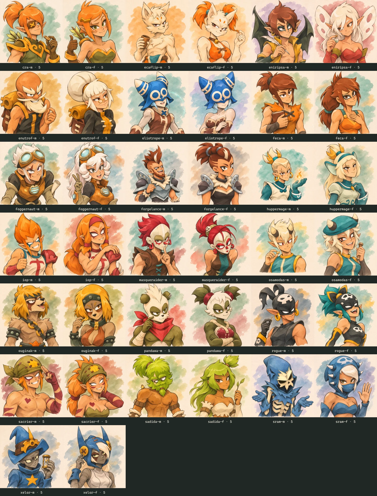
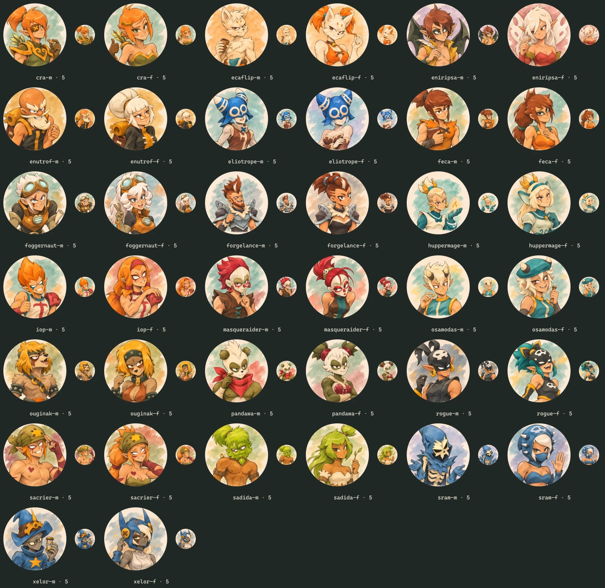
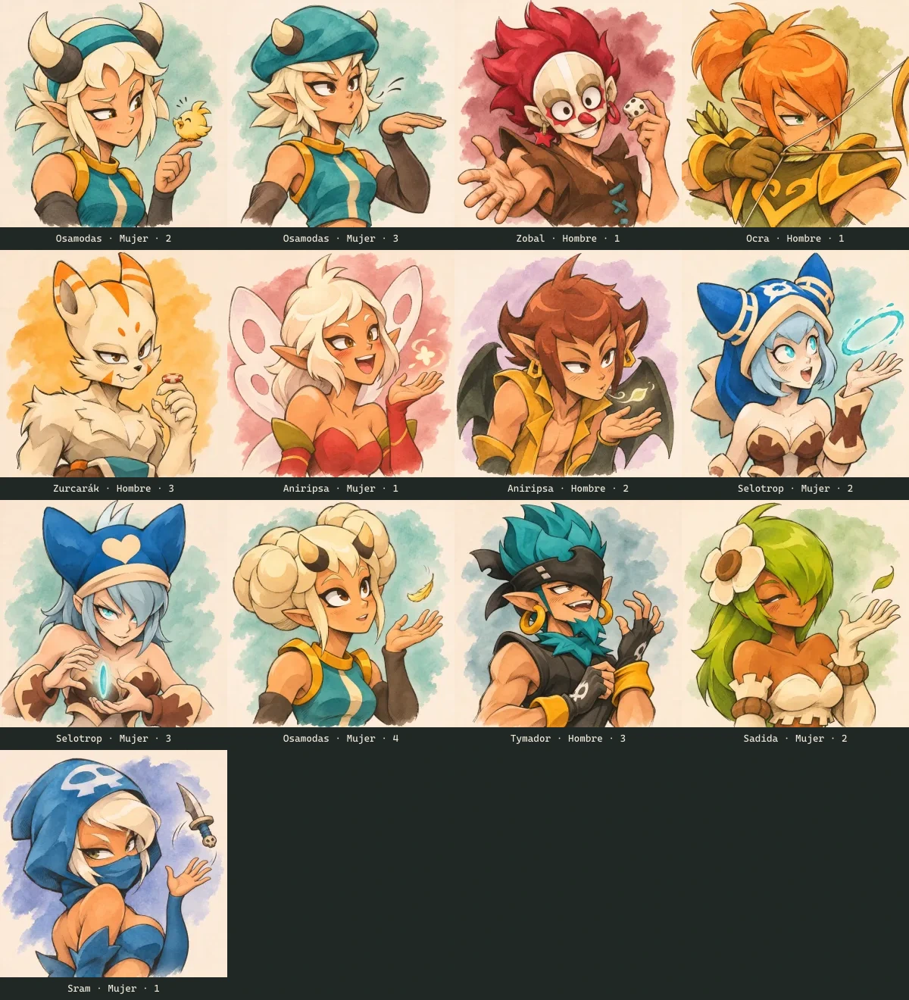
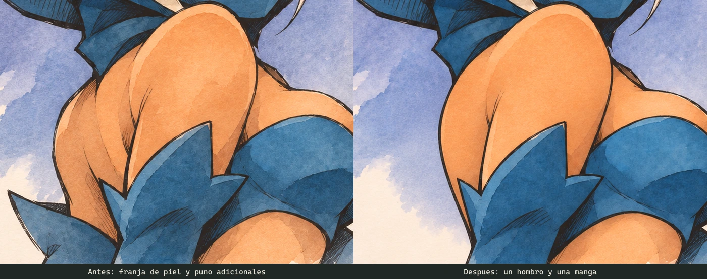
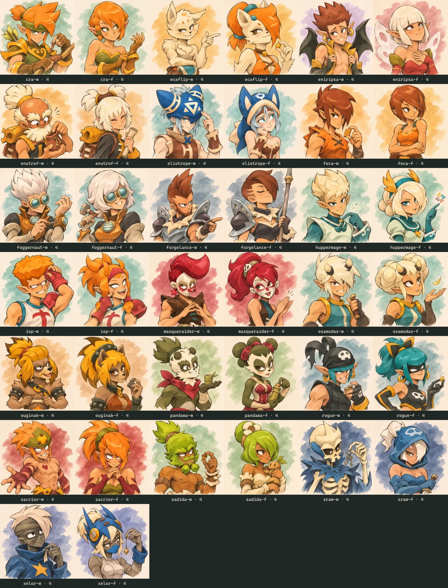
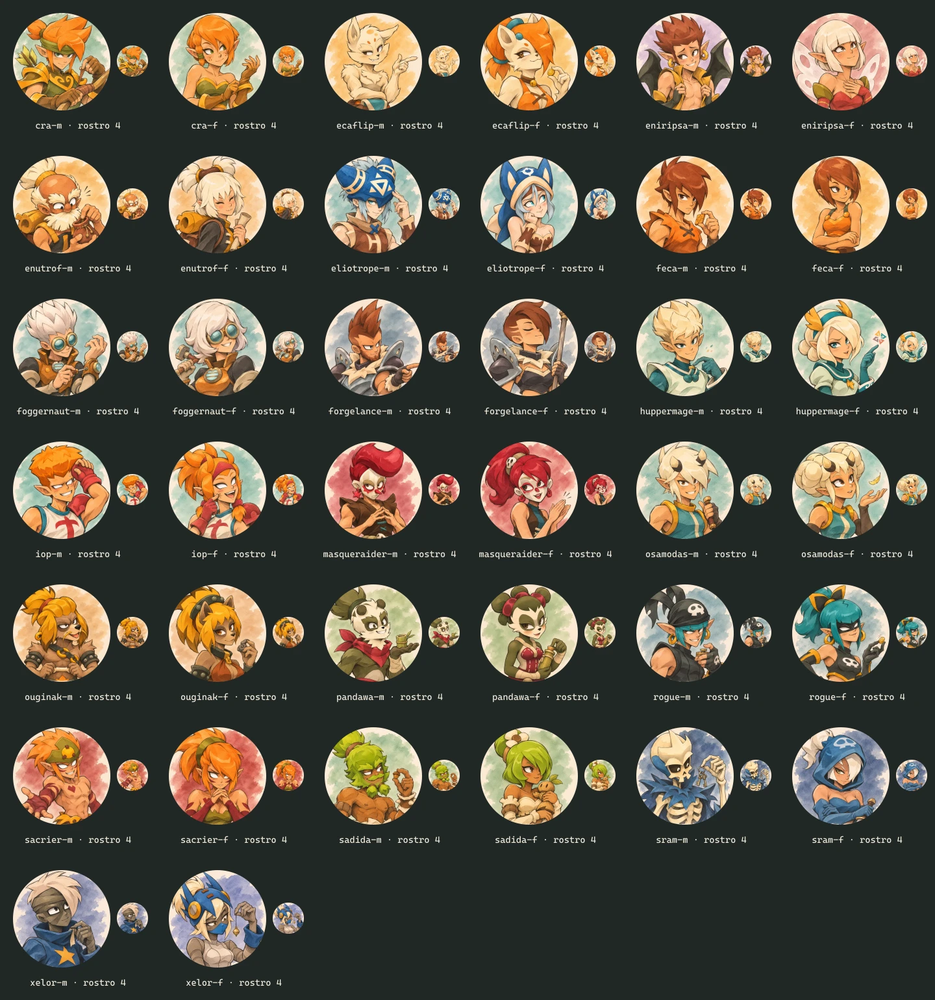

# Retratos de perfil de Forge

Colección original de fan art de las 19 clases de Dofus, basada en los modelos reales del cliente. Los primeros cinco rostros/peinados tienen versiones masculinas y femeninas: **190 retratos** con traje habitual, poses propias y el mismo acabado de tinta y acuarela.

- [Progreso por clase, sexo y modelo](PROGRESS.md): lista completa con casillas de los rostros hechos y pendientes; los trajes alternativos van al final.
- [Inventario del juego](game-looks.json): 600 rostros/peinados y 76 cuerpos de creación, incluidos los 38 trajes habituales y los 38 alternativos reservados para después.
- [Prompts y procedencia de cada imagen](manifest.json): prompt exacto, pose, referencias, hash y `gameLook` con posición, id y textura de cabeza/cuerpo.
- [Plantilla para continuar](prompt-template.json): conservar la técnica artística y los rasgos del modelo, inventando un gesto y expresión distintos para cada retrato.

## Rostro 5 — 2026-11-26

38 fan arts nuevos: quinto rostro/peinado de las 19 clases, hombre y mujer, con traje habitual y poses propias, basados en los modelos exactos del cliente DOFUS 3.7.14.18. **190/600 rostros terminados, 410 pendientes**. Los 38 trajes alternativos siguen mapeados para después.

El [registro de esta tanda](look-5-review.json) recoge la revisión individual ampliada y en círculo; el [manifiesto](manifest.json) conserva prompts exactos, referencias con hashes, modelos e intentos descartados. Los 152 retratos previos mantienen sus archivos y registros. Esta revisión cubre solo los 38 nuevos, sin sustituir la auditoría histórica de abajo.

Se restauró intacta la primera xelor mujer por preferencia del usuario. Se ajustaron el agarre de la taza del zurcarák hombre, ambas manos del sram hombre y la mano del pandawa hombre, incluido el último dedo señalado: pulgar recogido de forma natural y parcialmente oculto, sin el extremo grueso junto a la muñeca. Los descartes conservan sus prompts y hashes. La oclusión natural de los dedos se distingue de una mano completamente expuesta.

PNG nativos opacos en `temp/profile-avatars/masters/v1/<clase>-look-5-<m|f>.png`; WebP de 512 × 512 px en `public/avatars/classes/v1/`. Generados y editados con la herramienta integrada `image_gen`. El recorte circular es de presentación; se conserva la ilustración cuadrada para ampliar.

Aplicar `supabase/migrations/20261126010000_profile_art_fifth_heads_and_locations.sql` antes del despliegue: agrega únicamente las 38 rutas de retratos y ocho de banners. Conserva perfiles y permisos y admite repetición. No se ejecutó contra la base de datos alojada.

## Revisión visual de la colección — 2026-11-24

Se inspeccionaron individualmente los **152 PNG maestros** ampliados y los WebP públicos en recortes circulares de 150 y 48 px. La primera pasada dejó 139 sin anomalías evidentes y 13 hallazgos o dudas. **Los 13 retratos se corrigieron y volvieron a revisar individualmente**, ampliados y en ambos recortes. El [registro por imagen](visual-audit.json) vincula el resultado a los hashes finales y conserva el hallazgo anterior en `previousReview`. Los banners quedan fuera del alcance de esta revisión.

| Retrato | Corrección revisada | Estado |
| --- | --- | --- |
| [Ocra hombre · 1](../../../public/avatars/classes/v1/cra-m.webp) | Las dos ramas de la cuerda llegan al extremo posterior de la flecha, detrás de las plumas. | Corregido y revisado |
| [Zobal hombre · 1](../../../public/avatars/classes/v1/masqueraider-m.webp) | Cuatro dedos largos y un pulgar en la palma abierta en escorzo. | Corregido y revisado |
| [Osamodas mujer · 2](../../../public/avatars/classes/v1/osamodas-look-2-f.webp) | Mano izquierda con pulgar en el lado correcto; índice bajo el pío y tres dedos recogidos. | Corregido y revisado |
| [Osamodas mujer · 3](../../../public/avatars/classes/v1/osamodas-look-3-f.webp) | Cuatro dedos largos y un solo pulgar en la mano horizontal. | Corregido y revisado |
| [Zurcarák hombre · 3](../../../public/avatars/classes/v1/ecaflip-look-3-m.webp) | Mano y muñeca con pelaje crema, cinco dedos y pequeñas garras; eliminado el guante marrón inventado tras contrastar dos vistas completas del modelo. | Corregido y revisado |
| [Aniripsa mujer · 1](../../../public/avatars/classes/v1/eniripsa-f.webp) | Palma izquierda con cuatro dedos largos separados y un pulgar. | Corregido y revisado |
| [Aniripsa hombre · 2](../../../public/avatars/classes/v1/eniripsa-look-2-m.webp) | Cinco dedos distinguibles en la palma bajo el soplo. | Corregido y revisado |
| [Selotrop mujer · 2](../../../public/avatars/classes/v1/eliotrope-look-2-f.webp) | Cinco dedos visibles en la palma bajo el portal. | Corregido y revisado |
| [Selotrop mujer · 3](../../../public/avatars/classes/v1/eliotrope-look-3-f.webp) | Cinco dedos por mano, lateralidad y dos muñecas continuas alrededor del portal. | Corregido y revisado |
| [Osamodas mujer · 4](../../../public/avatars/classes/v1/osamodas-look-4-f.webp) | Palma izquierda con cinco dedos separados bajo la pluma. | Corregido y revisado |
| [Tymador hombre · 3](../../../public/avatars/classes/v1/rogue-look-3-m.webp) | Mano levantada con cuatro dedos flexionados y un pulgar, conservando el guante. | Corregido y revisado |
| [Sadida mujer · 2](../../../public/avatars/classes/v1/sadida-look-2-f.webp) | Cinco dedos con siluetas separadas en el guante abierto. | Corregido y revisado |
| [Sram mujer · 1](../../../public/avatars/classes/v1/sram-f.webp) | Eliminados la franja de piel y el puño adicional detrás del hombro que sugerían un tercer brazo. Se conserva la mano elegida por el usuario: índice y medio extendidos, anular y meñique plegados y un pulgar. | Corregido y revisado |

La aclaración del usuario ubicó el defecto de la sram en el hombro/espalda, no en su mano. En 0.4.27 se usó la versión que eligió como referencia y se corrigió esa silueta, descartando la variante de palma abierta. Se revisaron la imagen completa, el detalle del hombro y los recortes circulares. La ilustración anterior y ambos prompts quedan en el historial.

**El zurcarák hombre del rostro 4 se conserva sin cambios:** el usuario aclaró que estaba bien. Los otros 139 PNG y WebP mantienen sus hashes anteriores. Se conservan los rostros, trajes, expresiones y composición de los retratos editados. No cambian las rutas autorizadas ni los perfiles guardados; estas sustituciones no requieren una nueva migración.

Los PNG finales están en `temp/profile-avatars/masters/v1/` y los WebP públicos en `public/avatars/classes/v1/`. En el [manifiesto](manifest.json), `correctionHistory` conserva los prompts exactos de edición, referencias, hashes y notas de revisión; `originalGeneration` conserva la generación anterior. Los intentos descartados del zurcarák, la aniripsa y la sram también guardan prompt, hash y motivo. Se usó la herramienta integrada `image_gen`.

Esta revisión visual no garantiza una anatomía perfecta ni sustituye una comparación exhaustiva de las manos de los 152 modelos del juego. Cada futura edición debe revisar primero el retrato y sus referencias, y después su resultado ampliado y en círculo antes de aprobarlo o pasar al siguiente.

## Rostro 4

38 retratos nuevos para las 19 clases, masculino y femenino, con el cuarto rostro/peinado y el traje habitual del cliente DOFUS 3.7.14.18. Cada ilustración conserva el modelo exacto y tiene una pose propia. Los rostros anteriores siguen disponibles. El progreso actual es de 152/600 rostros terminados y 448 pendientes; los 38 trajes alternativos siguen reservados para después.

PNG originales en `temp/profile-avatars/masters/v1/<clase>-look-4-<m|f>.png`; la web usa `public/avatars/classes/v1/<clase>-look-4-<m|f>.webp` a 512 × 512 px. Cada entrada guarda el prompt exacto, pose, ids de cabeza/cuerpo, versión del cliente y hashes de las referencias y archivos finales. Dos renders del cuarto modelo establecen la identidad y el retrato aprobado aporta la técnica.

Aplicar `supabase/migrations/20261123050000_profile_art_fourth_heads_and_locations.sql` antes del despliegue. Agrega 38 retratos y ocho escenarios a los catálogos existentes, conserva perfiles y permisos, y puede repetirse. No se ha ejecutado contra la base de datos alojada desde este trabajo.

Las seis correcciones de anatomía de esta tanda conservan el prompt y PNG anteriores en `originalGeneration`, además del prompt exacto de edición y sus referencias. Se revisaron manos, lateralidad, continuidad de los dos brazos y un solo torso antes de actualizar los PNG y WebP.

## Rostro 3

38 retratos nuevos para las 19 clases, masculino y femenino, con el tercer rostro/peinado y el traje habitual del cliente DOFUS 3.7.14.18. Cada dibujo conserva su modelo exacto y tiene una pose y expresión propias. Los rostros 1 y 2 siguen disponibles. Esa tanda completó 114/600 rostros; los 38 trajes alternativos siguen reservados para después.

PNG originales: `temp/profile-avatars/masters/v1/<clase>-look-3-<m|f>.png`. La web usa `public/avatars/classes/v1/<clase>-look-3-<m|f>.webp` a 512 × 512 px. El manifiesto guarda el prompt exacto, pose, ids y texturas del modelo, versión del cliente, hashes de las referencias y hashes del PNG y WebP. La técnica se mantiene con el retrato aprobado; la identidad viene de dos renders del tercer modelo.

Antes del despliegue, aplicar `supabase/migrations/20261123040000_profile_art_third_heads_and_locations.sql`. Solo agrega 38 retratos y ocho escenarios a los catálogos existentes; conserva las fotos, portadas y permisos actuales. No se ha ejecutado en la base de datos alojada desde este trabajo.

## Rostro 2

El número identifica el rostro/peinado del juego, no una técnica artística diferente. Se usa el traje habitual; los trajes alternativos se producirán después de los rostros. La posición empieza en 1 y sigue `order` e `id` del cliente. Las etiquetas internas no siempre son consecutivas: usar los ids guardados para reproducir el modelo exacto.

Los originales PNG están en `temp/profile-avatars/masters/v1/`. La web usa WebP opaco de 512 × 512 px con el fondo de acuarela incluido. Los primeros retratos conservan `<clase>-<m|f>.webp`; los nuevos usan `<clase>-look-2-<m|f>.webp`. El recorte circular se aplica al mostrar el perfil, conservando la ilustración cuadrada completa para ampliarla.

## Continuar otra tanda

1. Ejecutar `python scripts/extract-avatar-looks.py --export-head <posición>` con el cliente del juego instalado. Exporta referencias locales y actualiza el inventario sin cambiar los modelos usados por el planificador.
2. Renderizar el rostro seleccionado desde dos ángulos con el renderer existente; observar sus diferencias. Algunos rostros cambian la máscara o eliminan la capucha/sombrero.
3. Revisar las poses existentes, elegir una nueva y generar una ilustración por sexo usando el retrato aprobado como referencia de técnica y los renders como referencia de identidad.
4. Revisar manos, silueta, rasgos del modelo y recorte circular pequeño. Guardar PNG, WebP y cada prompt exacto en el manifiesto; mantener las imágenes aprobadas anteriores.
5. Ejecutar `node scripts/sync-avatar-progress.mjs`. Solo tacha retratos con archivo, hash y prompt verificados. Los demás quedan pendientes.
6. Registrar únicamente los retratos terminados en el selector y en una migración aditiva de `profile_avatar_catalog`, reflejada en `schema.sql`. Los prompts y el progreso viven en el repositorio; la base de datos solo autoriza rutas públicas exactas.

## Publicación del rostro 2

Aplicar `supabase/migrations/20261123020000_profile_avatar_second_heads.sql` en Supabase **antes de publicar el selector ampliado**. El despliegue del frontend no ejecuta migraciones SQL. Esta migración solo agrega las 38 rutas nuevas; conserva las fotos guardadas, las rutas anteriores y los permisos del catálogo. Puede repetirse sin duplicar entradas. No se ha ejecutado contra producción desde este trabajo.
