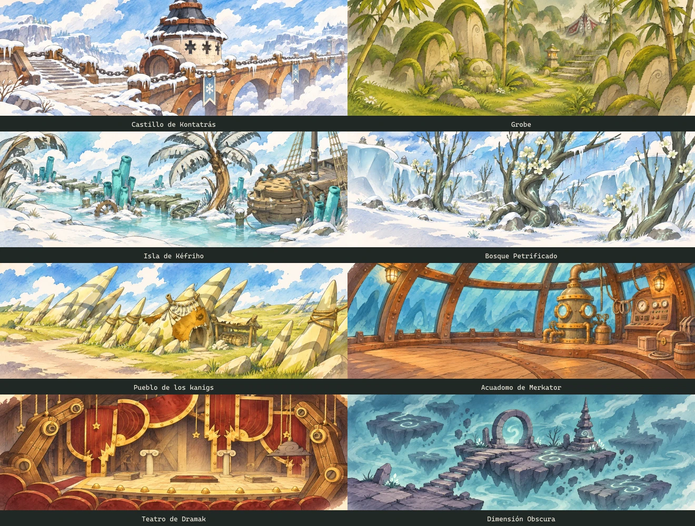
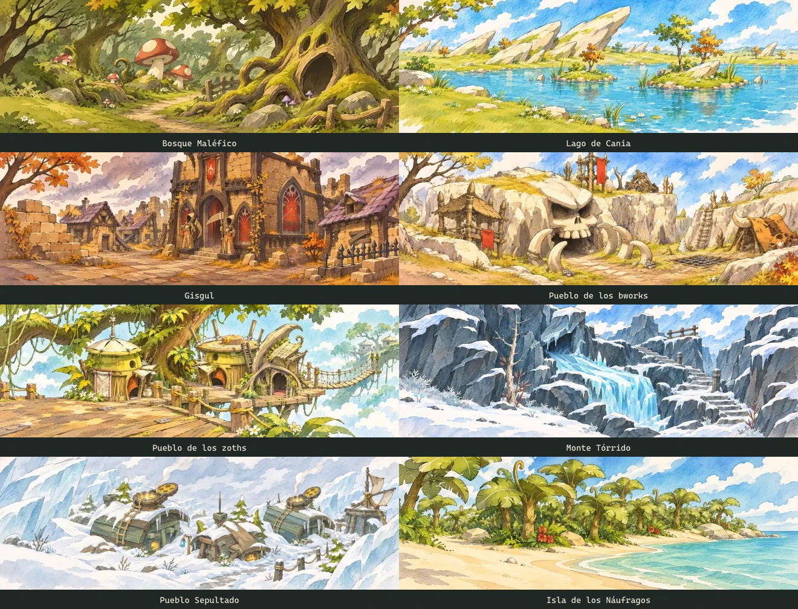
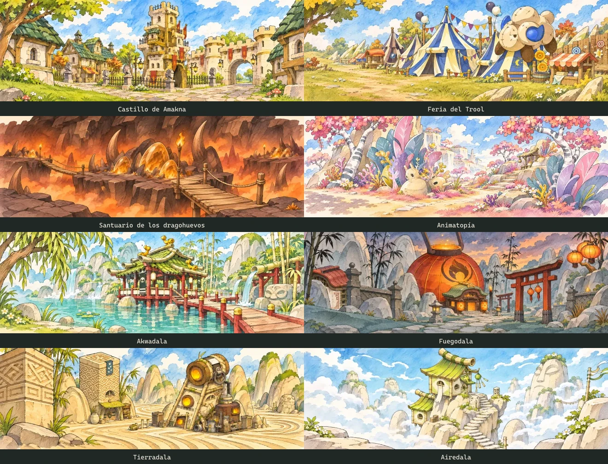
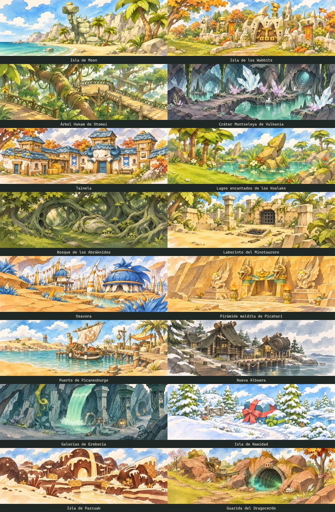

# Forge location banners

Original environment fan art for profile covers, paired with the approved Forge ink-and-watercolor class portraits. Target: **DOFUS 3.7 / Unity**. Artwork was introduced in Forge 0.4.10; Forge 0.4.11 adds the Account picker, saved choices and public profile covers.

## Fifth collection — Forge 0.4.24

**52 selectable landscapes**, including eight new original ink-and-watercolor panoramas based on the installed DOFUS **3.7.14.18** client. The earlier 44 artworks and records are preserved. Each new native illustration and desktop/mobile crop was inspected individually; see [review records](expansion-4-review.json). Exact prompts, reconstructed-map reference hashes and localized source names are saved in [the manifest](manifest.json).



| Scene | Source map ids |
|---|---|
| Castillo de Kontatrás | `108922368`, `111150592` |
| Grobe | `206833153`, `206832645` |
| Isla de Kéfriho | `54159142`, `54160681` |
| Bosque Petrificado | `60033539`, `60034053` |
| Pueblo de los kanigs | `126093082`, `126094104` |
| Acuadomo de Merkator | `119276033`, `119277065` |
| Teatro de Dramak | `118230016`, `118230020` |
| Dimensión Obscura | `121634820`, `121634816` |

Opaque PNG masters are retained locally in `temp/profile-banners/masters/v1/`; web assets are 1920 × 640 WebP in `public/banners/locations/v1/`. Generated with built-in `image_gen`. The game references were reconstructed from installed map planes, not screenshots; renderer artifacts were excluded from the illustrations.

Apply `supabase/migrations/20261126010000_profile_art_fifth_heads_and_locations.sql` before deploying the expanded choices. It adds 38 portrait and eight banner paths without changing profile rows or permissions. Hosted SQL was not executed.

## Collection v1

| ID | Location | Recognizable focus |
| --- | --- | --- |
| `bonta` | Bonta | White stone, blue roofs and pennants, winged sword fountain |
| `brakmar` | Brakmar | Riveted iron forges, horn-shaped roofs, chains and lava |
| `astrub` | Astrub | Slender ivory Hyperzaap, curved roofs and market lanes |
| `incarnam` | Incarnam | Floating golden plateau and round turquoise departure portal |
| `amakna` | Amakna | Round-roofed village tavern, timber, grass and old trees |
| `sufokia` | Sufokia | Sandstone quays, wooden bridges, turquoise sea and small boats |
| `pandala` | Pandala | Green bamboo-roofed gate, bamboo bridge and misty water |
| `frigost` | Frigost | La Bourgade's steep roofs, heavy snow, icicles and warm windows |
| `anutropia` | Anutropía / Enutrosor | Golden vaults, keyhole pillars, kama drifts and teal crystals |
| `sramvil` | Sramvil / Srambad | Angular indigo streets, bone ladders, skull details and ghost lanterns |
| `zurcalia` | Zurcalia / Ecaflipus | Floating game-board terraces, ivory cat guardian and giant dice |
| `xelorium` | Xelorium | Floating clockwork platforms, hourglass monument and time fractures |
| `moon` | Isla de Moon | Raised-arm stone monkey monument, pale cliffs, palms and turquoise shore |
| `wabbits` | Isla de los Wabbits | Rabbit-eared castle walls, golden keyholes, carrot pennants and rabbit statues |
| `otomai` | Otomai — Árbol Hakam | Giant branches, curved wooden platforms, canopy bridges and vine railings |
| `vulkania` | Vulkania — Cráter Montseleya | Volcanic stone bridges, mineral-turquoise pools and white/lavender crystal clusters |
| `tainela` | Tainela | Royal Gobball ram relief, rustic cream-and-timber buildings and blue shingle roofs |
| `koalaks` | Lagos encantados de los Koalaks | Tier-leaf Kaliptus trees, tilted mossy rocks, clear ponds and white flowers |
| `abraknid` | Bosque de los Abráknidos | Interlocking gray-green roots, hollow trunk archways and mossy woodland paths |
| `minotoror` | Laberinto del Minotauroro | Sandy maze ruins, barred passage, lever, floor grate and curling tropical foliage |
| `osavora` | Osavora | Golden terraces, blue organic domes and ivory horn-like pillars |
| `saharach` | Pirámide maldita de Picahari | Cursed Pyramid guardian-head gateway and gold sandstone |
| `sarakech` | Puerto de Picanesburgo | Picanesburgo / Sarakech harbor, broad sail and desert timber jetty |
| `albuera` | Nueva Albuera | Steep-roofed northern log houses and a quiet wooden quay |
| `ereboria` | Galerías de Ereboria | Jade waterfall, angular slate cliffs and broken carved stone pillars |
| `nawidad` | Isla de Nawidad | Snow-covered firs and oversized ribbon-wrapped gifts |
| `pazcuak` | Isla de Pazcuak | Chocolate hills, ivory cream stream and wafer paths |
| `dragocerdo` | Guarida del Dragocerdo | Pig-snout rock entrance, olive grass and abandoned mine rails |
| `amakna-castle` | Castillo de Amakna | Cream watchtower, red banners, crenellated gateway and green-roofed houses |
| `trool-fair` | Feria del Trool | Striped circus tents, round carnival attraction, little booths and pennants |
| `dragoeuf` | Santuario de los dragohuevos | Amber egg forms, horn-shaped spires, narrow ledges and rope bridges |
| `nimotopia` | Animatopía | Pastel fan leaves, white trunks, coral foliage and cream cliffs |
| `akwadala` | Akwadala | Red timber water pavilion, green bamboo roofs, willow fronds and waterfalls |
| `feudala` | Fuegodala | Spherical orange furnace dwelling, red gates and pumpkin lanterns |
| `terrdala` | Tierradala | Carved ochre columns, raked sand and triangular stone workshop |
| `aerdala` | Airedala | Cloud-wrapped pale pinnacles, winding steps and a green-roofed wind-house |

`manifest.json` preserves every exact generation prompt, reference source, asset hash and export dimensions. `prompt-template.json` records the reusable art direction. The game version recorded in the manifest comes from `public/data/version.json` when the assets were prepared; it is a target, not a claim that every source reference was captured in that patch. Reference publication dates vary, including the city and Pandala redesigns; original URLs remain in the manifest for review. This is an original illustrated interpretation of the places, not a screenshot pack or a literal reconstruction of a map.

## Files and framing

- Web delivery: `public/banners/locations/v1/<id>.webp`, opaque, panoramic 3:1.
- Original PNG masters: `temp/profile-banners/masters/v1/<id>.png`, retained locally outside Git.
- Collection overview: `collection-preview.webp` beside this file.
- Exact prompts and sources: `manifest.json` beside this file.

The full illustration includes its paper-colored background and watercolor. Keep the recognizable landmark within the central area, and allow room at the lower-left for a profile picture overlay. Use `object-fit: cover` with a centered focal area when integrating the picker; inspect desktop and narrow crops before choosing a different banner aspect ratio. Do not bake profile UI, labels, gradients or avatar circles into the artwork.

## Eight further scenes in Forge 0.4.25

That expansion brought the collection to 44 landscapes. These eight additions use installed DOFUS **3.7.14.18** map data and graphics for identity, with original panoramic compositions in the approved ink-and-watercolor style. The previous 36 artworks and prompt records are preserved. Evil Forest uses the current Dark Vlad labyrinth maps; the manifest retains their precise localized subarea names alongside the broader collection label.



| Scene | Source map ids in client 3.7.14.18 |
|---|---|
| Bosque Maléfico | `221249538`, `220987911` |
| Lago de Cania | `156238853`, `156237833` |
| Gisgul | `172492290`, `172491781` |
| Pueblo de los bworks | `104071684`, `104072710` |
| Pueblo de los zoths | `28051456`, `28050436` |
| Monte Tórrido | `54167370`, `54168907` |
| Pueblo Sepultado | `54174535`, `54173511` |
| Isla de los Náufragos | `153346`, `153089` |

Apply `supabase/migrations/20261123050000_profile_art_fourth_heads_and_locations.sql` before deploying these choices. The same additive migration registers the fourth class faces and preserves existing profile rows and catalog permissions. Hosted SQL has not been executed by this work.

## Eight further scenes in Forge 0.4.18

Forge 0.4.18 expanded the collection to 36 selectable landscapes. These eight additions use only identity references reconstructed from installed DOFUS **3.7.14.18** map data and graphics, with the same approved ink-and-watercolor technique. Pandala's four elemental areas retain their current redesigned landmarks and their own material, palette and atmosphere. The previous 28 artworks and prompt records are preserved.



| Scene | Source map ids in client 3.7.14.18 |
|---|---|
| Castillo de Amakna | `68552193`, `68552195` |
| Feria del Trool | `139723778`, `139724803` |
| Santuario de los dragohuevos | `198182400`, `198181889` |
| Animatopía | `179307010`, `180093952` |
| Akwadala | `204997891`, `204999680` |
| Fuegodala | `206177282`, `206045185` |
| Tierradala | `205259780`, `205261570` |
| Airedala | `209192710`, `209193217` |

Apply `supabase/migrations/20261123040000_profile_art_third_heads_and_locations.sql` before deploying these choices. This additive migration also registers the third class faces. Existing profile rows, choices and permissions are retained. Hosted SQL has not been executed by this work.

## Expansion from the DOFUS 3.7 client

The sixteen additional scenes use identity references reconstructed directly from the installed **DOFUS 3.7.14.18** client. Its `Dofus_Data/StreamingAssets/version` file reports that exact patch and a build date of 2026-11-16. The references use that installation's map data and 1x graphic assets. The existing Bonta illustration supplies the ink-and-watercolor technique only.



| Banner | Source map ids in client 3.7.14.18 |
|---|---|
| Moon | `156500737` |
| Wabbits | `99614979` |
| Hakam / Tree Keeholo | `25694209`, `63964931` |
| Vulkania | `75762694` |
| Tainela | `120063489`, `121375235` |
| Koalak lakes | `75497732` |
| Treechnid forest | `147849218` |
| Minotoror | `152849`, `136316674` |
| Osavora | `234622214`, `235406081` |
| Pirámide maldita de Picahari | `175637504`, `175641603` |
| Puerto de Picanesburgo | `173277701`, `173277700` |
| Nueva Albuera | `223348996`, `223346946` |
| Galerías de Ereboria | `223086337`, `223086088` |
| Isla de Nawidad | `66061312` |
| Isla de Pazcuak | `196870152` |
| Guarida del Dragocerdo | `72618499`, `72351744` |

Saharach (French), Ohwymi (English) and Picahari (Spanish) name the same region. The expansion includes two distinct scenes from it: the Cursed Pyramid and Picanesburgo / Sarakech Port. These are separate artworks, not duplicate regional entries.

To reproduce a reference, install the same extraction dependencies used by `scripts/extract-characters.py`, then run:

```powershell
python scripts/render-banner-references.py 75497732 koalaks --require-version 3.7
```

The script checks the installed version before rendering, writes a local PNG and provenance JSON, and leaves game files untouched. These are static reference planes: runtime lighting, particles and special blend shaders are omitted, with the source neutral vertex tint normalized for legibility. They are not game screenshots or final banners. The new illustrations interpret the verified landmark assets in original panoramic compositions. Each new manifest entry records the client patch, source map ids, map bundle hashes, reference image hashes, exact prompt and final image hashes. Localized location terms were checked against the same client's language tables.

Apply `supabase/migrations/20261123030000_profile_banner_expansion.sql` before publishing the expanded picker. It adds sixteen paths to the existing approved catalog and preserves saved covers, old entries, grants and ownership policies. It is safe to replay. It has not been run against the hosted database from this work.

## Continuing the collection

The initial delivery belongs to **Forge 0.4.10**. Keep expanding the collection in later releases; the open roadmap item tracks more locations and dimensions without limiting it to the twelve already delivered.

Start with the approved portrait style reference and real game environment references. Verify the target place against the current Unity version and preserve its architectural identity. Give each place its own composition, palette and mood. Apply the reusable template, inspect the full panorama and a narrow crop, and append the exact final prompt, source URLs, dimensions and hashes to the manifest. Export the optimized WebP while retaining the original PNG locally. Do not replace previous assets silently; use a new collection version for later revisions.

Register new choices in `src/features/account/profileBanners.ts` and translate their place labels in all four locales. Add their exact paths to `public.profile_banner_catalog` through a new admin-authored migration and mirror the inserts in the cumulative schema. API clients cannot expand this allowlist. The catalog parity check reads the cumulative schema, so later migrations can add places without rewriting an earlier migration. Apply the migration before publishing new choices.

## Database rollout for 0.4.11

Apply `supabase/migrations/20261123000000_profile_banner_catalog.sql` before releasing the picker. It reuses `profiles.banner_url`, seeds the twelve approved paths and adds a validated foreign key. Existing custom or external covers are reset to null; approved covers and other editable profile fields are preserved. Replaying the migration is safe. Frontend deployment does not apply SQL migrations, and the Database workflow uses a disposable stack rather than the hosted project.

The renderer and save action also enforce the exact bundled paths. A null value means no banner. Selection remains an Account draft until Save; Discard restores the stored choice. Public profiles load the saved path independently and display it above the portrait. Both public and draft covers open the full illustration on click, using a zoom cursor without an icon overlay.
