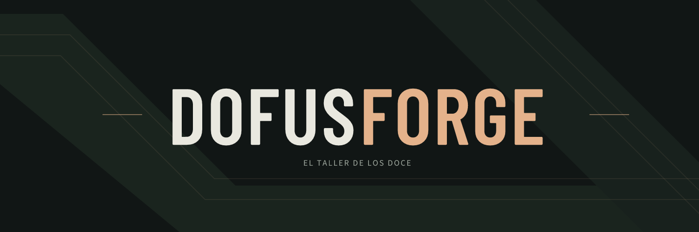

# Portada de Dofus Forge para X

[Descargar PNG](dofus-forge-x-banner-es-1500x500.png) · [Fuente SVG](dofus-forge-x-banner-es-1500x500.svg)

1500 × 500 px, PNG opaco. Cabecera de identidad con el nombre como protagonista, fondo geométrico verde oscuro y el acento cálido del avatar actual. El nombre y el lema quedan centrados, con la esquina inferior izquierda reservada para la superposición de la foto de perfil. Los elementos principales guardan margen arriba, abajo y a la derecha; comprobar la vista previa al subirla, ya que el encuadre puede variar según el dispositivo.

Usa el nombre vectorial actual de `public/brand/wordmark.svg`, conservando exactamente sus contornos y colores. El lema también se convierte en contornos para que el SVG no dependa de fuentes instaladas. No se usa generación de imágenes con IA.

Regenerar con `node scripts/build-brand-v04.mjs --x-banner`. Esta opción solo exporta la portada; conserva los demás recursos de marca y la aplicación. Utiliza las fuentes originales de `src/worker/fonts/` y los colores del kit actual.

Fecha: 2026-11-25. Dimensiones de referencia: [ayuda oficial de X](https://help.x.com/en/managing-your-account/how-to-customize-your-profile).
