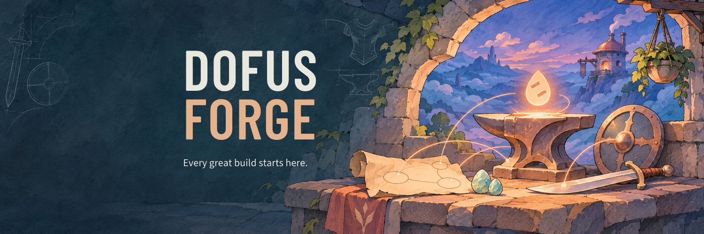

# Dofus Forge — illustrated X header

[Download PNG](dofus-forge-x-banner-en-1500x500.png) · [Editable SVG](dofus-forge-x-banner-en-1500x500.svg) · [Exact prompt and provenance](x-banner-en-manifest.json)

An original imagined workshop above a cloud-filled valley: an enchanted anvil, equipment and a blank build-planning parchment. The stacked name and English line, **“Every great build starts here.”**, sit on the quiet left wall. The artwork uses the collection’s ink-and-watercolor technique and the warm accent from the live brand. This is an original fantasy scene, not a literal game location.

The opaque PNG is **1500 × 500 px**. Important text starts at x=390, away from the lower-left profile-picture overlap, with space above and below. Inspect the upload preview because display cropping can vary by device.

The background was created with built-in `image_gen`, using the existing Bonta fan-art banner only as a medium reference and the live anvil/flame symbol as a brand reference. Exact prompts, reference roles, hashes and review notes are saved in the manifest. Typography uses the existing Barlow Condensed and Source Sans fonts, converted to paths. All visible copy is English.

The SVG embeds the full original generated background losslessly and keeps the brand text as vector paths. The native PNG also remains locally at `temp/x-banner-creative/background-master.png`. Render with `node scripts/build-brand-v04.mjs --x-banner`; this retains the embedded background, rebuilds the English outlines and exports only the header. It does not regenerate the illustration or change application assets.

The earlier Spanish geometric files remain as an archived draft; the English illustrated header above is the current proposal.

Created 2026-11-25. Dimensions reference: [X Help Center](https://help.x.com/en/managing-your-account/how-to-customize-your-profile).
