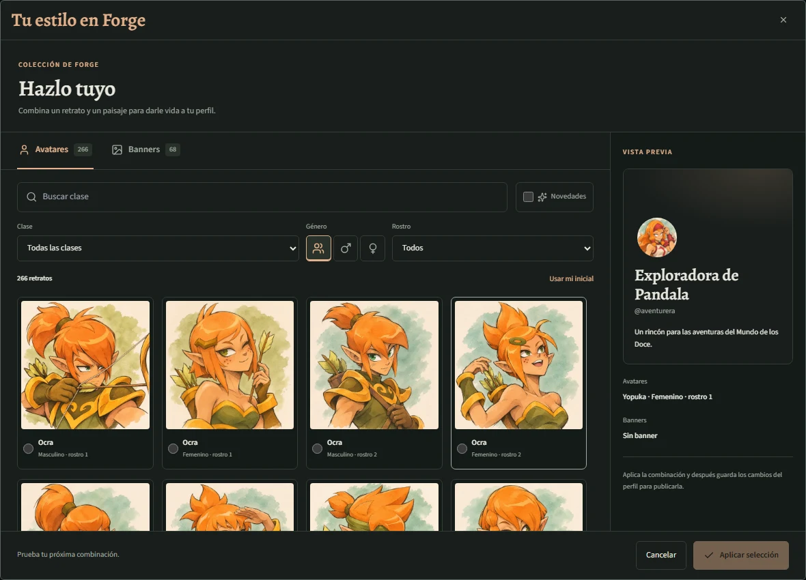
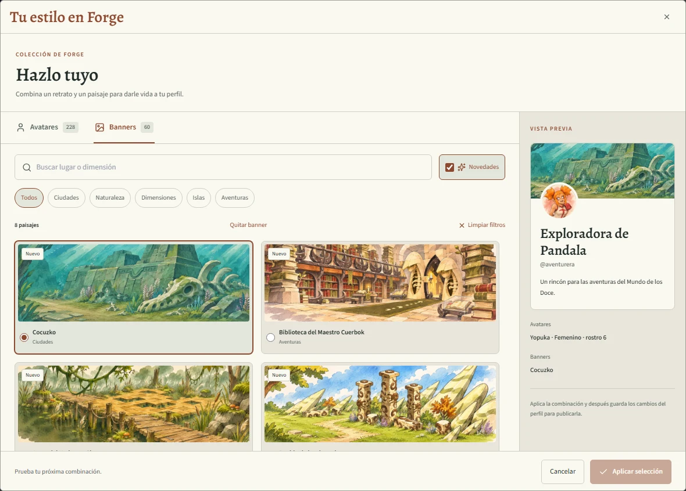
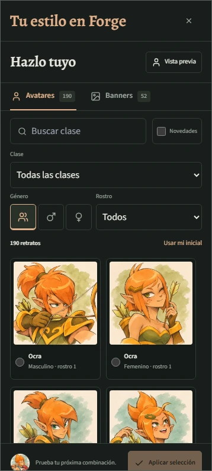
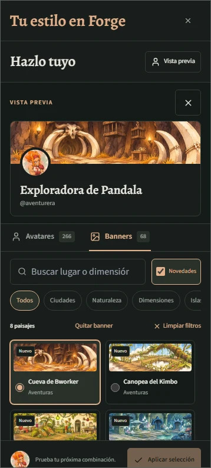

# Personalización del perfil — 0.4.26

Galería real de Cuenta para combinar los 266 avatares y 68 banners. La interfaz usa las ilustraciones existentes, los colores de Forge y las traducciones de español, inglés, francés y portugués.

## Elegir y guardar

1. Abrir **Personalizar perfil**, el avatar o el botón de banner desde Cuenta.
2. Filtrar retratos por clase, rostro y género. Los tres botones de género son todos, masculino y femenino; incluyen etiquetas al pasar el cursor, foco visible y nombres accesibles. Buscar paisajes por nombre y ambiente, o activar las novedades.
3. Pulsar una ilustración para ampliarla. Esto no la selecciona. Al volver se conservan filtros, foco y posición de desplazamiento.
4. Seleccionar un retrato y un banner para ver la combinación. Las dos pestañas comparten el borrador y conservan sus propios filtros.
5. **Aplicar selección** prepara ambos cambios en el formulario. **Guardar perfil** los publica. Cancelar o cerrar la galería descarta esa prueba; el descarte del formulario y el reintento tras un fallo siguen disponibles.

En móvil, los retratos y banners tienen dos columnas y la vista previa se despliega desde su botón. Clase ocupa una fila completa en pantallas estrechas, dejando espacio para los tres botones de género de 44 px y el rostro.

## Implementación y revisión

- [Componente de la galería](../../../src/features/account/ProfileAppearancePicker.tsx), con estilos propios y el catálogo de categorías cargado con Cuenta.
- El catálogo de banners se carga al editar el banner para mantener las demás páginas dentro de su presupuesto de JavaScript.
- El guardado mantiene las rutas exactas permitidas por el servidor. La ampliación 0.4.26 a siete rostros y 68 paisajes necesita la [migración aditiva del catálogo](../../../supabase/migrations/20261126040000_profile_art_seventh_heads_and_locations.sql) antes del despliegue; los perfiles, permisos e imágenes anteriores se conservan.
- Pruebas de Cuenta para combinación, cancelación, aplicación, guardado, fallo y reintento, filtros combinados y navegación por teclado; comprobación del mapeo de categorías e idiomas.
- Flujo de navegador sobre Cuenta y perfil público con persistencia local simulada, ampliación, retorno de foco y diseños de 320 y 390 px. Revisión axe de ambos temas y de móvil, limitada a la nueva galería.

Las capturas proceden de la implementación local con datos de prueba. No muestran una cuenta real ni son imágenes generadas.
