# Racha, recompensas y marcos — 0.4.28

## Extensión de la 0.4.29

La cuenta muestra **builds usadas / cupo actual**, plazas por racha activa y
días hasta la siguiente plaza, debajo del progreso y separado de las imágenes.
Las reglas del desplegable explican que la racha activa concede +1 cada cinco
días sobre el cupo base o de rango y que perder el bono conserva todas las
builds y su edición. Las cuentas de rango ilimitado muestran su estado real.

Los administradores ven «Acceso de administrador» y todas las imágenes
disponibles, sin progreso ficticio ni récord fabricado. Los marcos siguen
correspondiendo al récord real. La galería usa la elegibilidad de la RPC,
incluida la excepción del administrador, y el servidor valida el guardado.

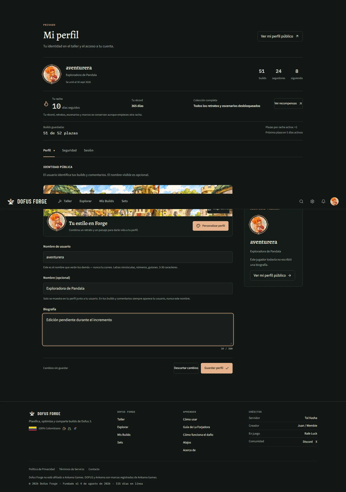

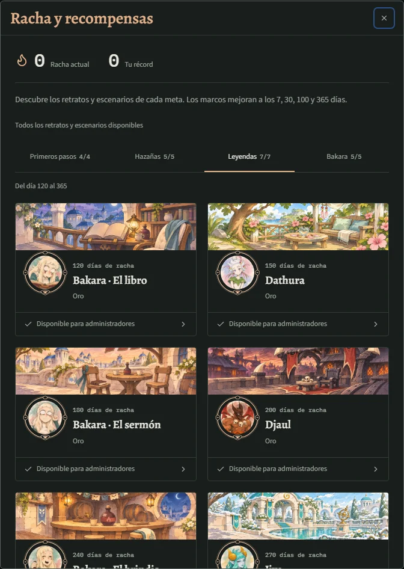

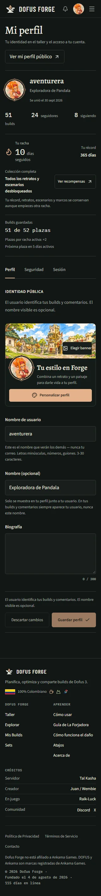

Comprobaciones de 0.4.29: cuenta normal, rango finito e ilimitado, récord
permanente después de reiniciar, administrador con racha cero y selección
de Ogrest, cuatro idiomas y 320 px, ambos temas y Axe sin infracciones
en los estados comprobados. La base local pasa 125 aserciones pgTAP; dos
sesiones que compiten por la última plaza solo consiguen una inserción.

Petición del usuario, 2026-11-27: conservar la **llama original** y revisar
ubicación, ventanas y marcos siguiendo el diseño de la 0.4.0. Se mantienen
las superficies verde oscuro y papel claro, acento melocotón, tipografía
Alegreya/Source Sans e indicadores numéricos IBM Plex Mono.

## Ubicación y jerarquía

- **Perfil público:** el récord ocupa la cuarta estadística, después de
  builds, likes y comentarios. Se elimina el chip junto a la fecha de alta.
  No se publica la racha activa; sin récord se conservan tres estadísticas.
- **Cuenta:** un bloque entre identidad y pestañas presenta racha activa,
  récord, siguiente personaje y días consecutivos restantes. Sigue visible
  desde Seguridad y Sesión; queda fuera del formulario de edición.
- **Menú de cuenta:** «Tu racha» con la misma llama abre directamente
  `/account#streak-rewards`. La cabecera conserva su disposición habitual.

El progreso usa la racha **activa**, mientras que marcos y metas alcanzadas
usan el **máximo histórico**. Si alguien reinicia en 4 con récord 45, conserva
Kerubim, Joris, Atcham, Julith y Bakara normal; necesita otros 56 días
consecutivos para llegar a Jahash, el siguiente hito no ganado.
No se inventan días de asistencia ni se afirma que la visita actual ya sumó:
el cliente no dispone de ese historial. El cómputo diario UTC sigue en M188.

## Ventana y selección

La ventana muestra racha actual, récord y 16 pares de retrato/escenario,
separados en tres etapas cronológicas (4/5/7 recompensas) y una colección
de Bakara con sus cinco variantes. Las pestañas muestran ganadas/total,
admiten flechas, Inicio y Fin y usan dos columnas en móvil. En el día 90
se anuncian y resaltan **Otomaï y Bakara borracha**, sin ocultar uno de ellos.
Cada tarjeta muestra su marco, hito y estado y permite inspeccionar ambas piezas,
incluso bloqueadas. Volver recupera el foco de la tarjeta; Escape cierra y
devuelve el foco al acceso inicial. El botón de cierre tiene 44 × 44 px.

Una recompensa elegible abre la galería existente en su retrato, sin apilar
ventanas. Elegir, aplicar y guardar siguen siendo pasos distintos. Cancelar
conserva la biografía y los demás cambios pendientes. La elegibilidad para
seleccionar procede de `get_my_exclusive_unlocks`; el servidor continúa
validando el guardado. La ampliación solo añade doce filas al catálogo SQL;
conserva las RPC, políticas, premios previos y cuatro hitos de marcos.

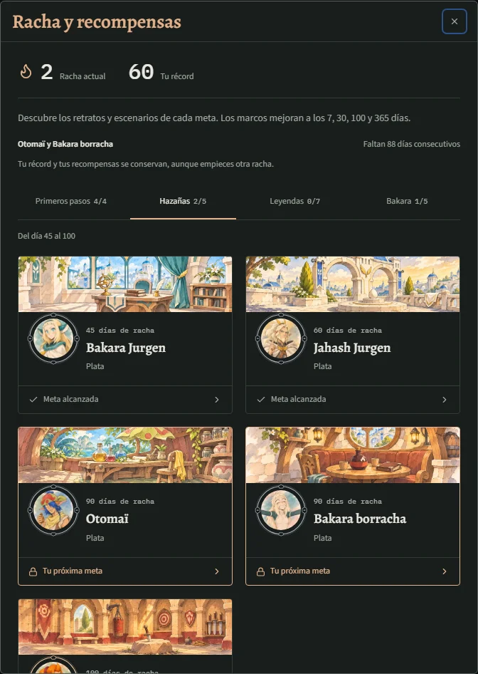

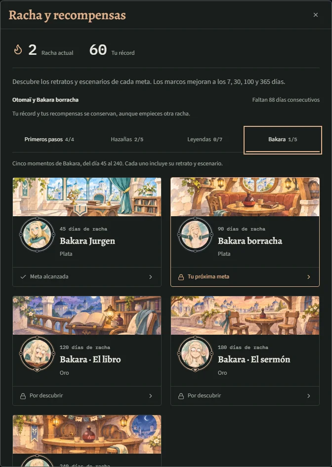

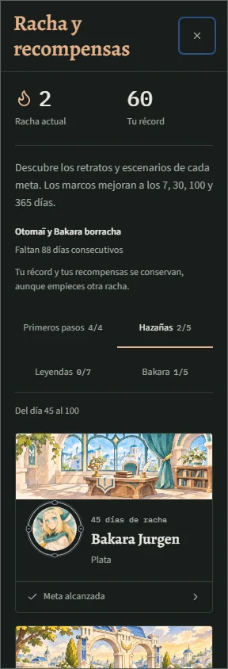

## Marcos

Geometría SVG escrita a mano y CSS: aro mate, cierres laterales y remaches.
Plata incorpora grabado doble; oro añade el sello de yunque; Ancestral
añade incrustaciones oscuras y pequeños acentos de cobre rojizo. El nombre
interno `molten` permanece compatible. No hay halos, desenfoques, degradados,
partículas ni animaciones. El retrato sigue siendo el foco visual.

Se aplican a los avatares grandes de Cuenta, resumen/vista previa de la
galería y perfil público, incluyendo el marcador inicial si falta retrato.
La miniatura de la cabecera conserva su tamaño y muestra también el retrato
exclusivo guardado. En colores forzados los adornos usan colores del sistema.

## Capturas y validación

Capturas del código real con cuenta de prueba y respuestas de lectura
simuladas; no representan una cuenta ni datos de producción.

| Cuenta | Perfil público |
|---|---|
| 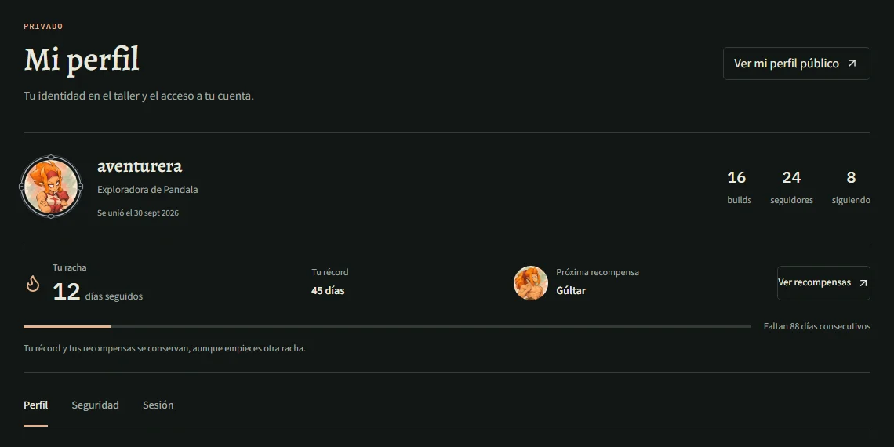 | 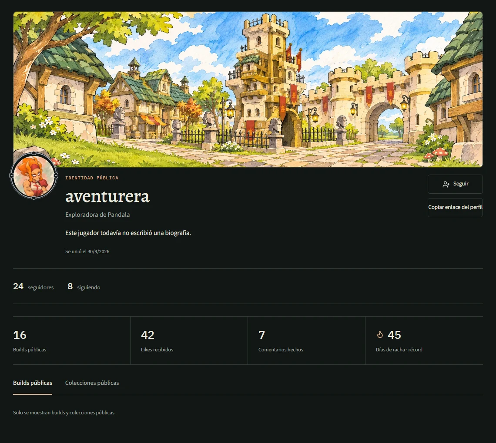 |

| Recompensas, oscuro | Recompensas, claro |
|---|---|
| 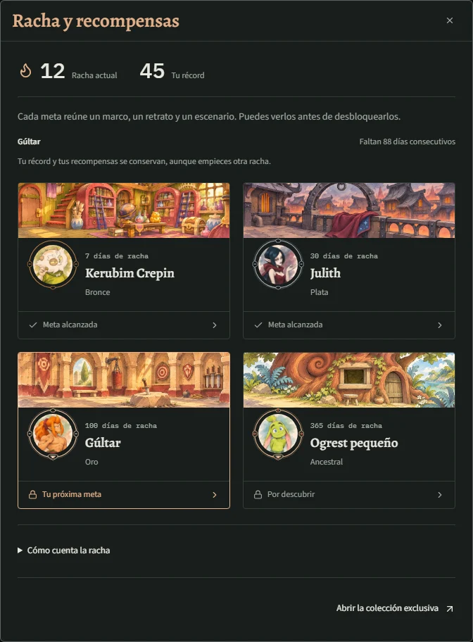 | 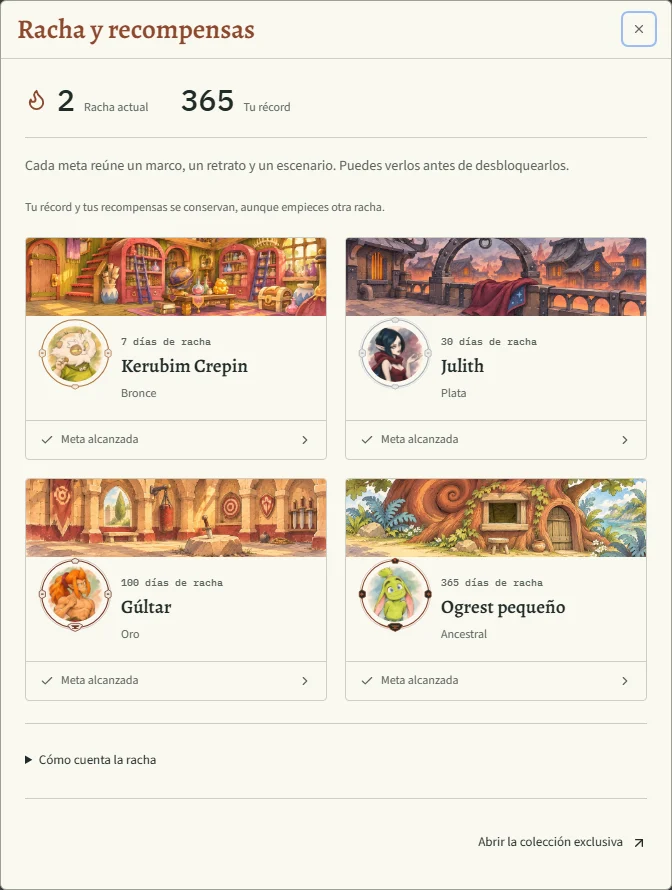 |

| Detalle de recompensa | Móvil de 320 px |
|---|---|
| 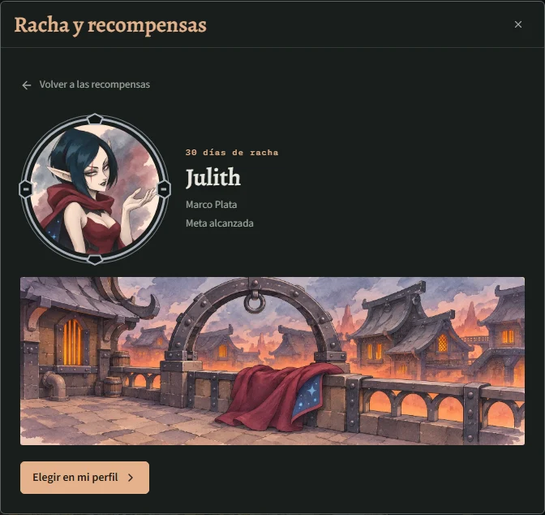 | 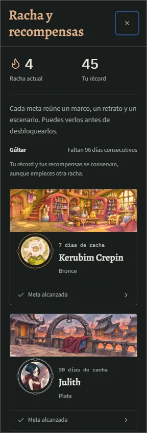 |

Comprobados en Chromium: acceso desde el menú y Seguridad, inspección
bloqueada, elegibilidad, selección/aplicación/guardado explícitos, cancelación
sin perder edición, foco y Escape; récord después de reiniciar; anchos
320/390 px sin desbordamiento y cuatro idiomas. Axe no detectó infracciones
automáticas en el bloque ni en la ventana, en móvil y ambos temas; esto no
sustituye una auditoría manual completa de accesibilidad.
